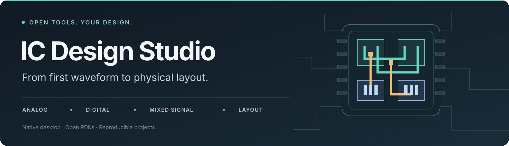
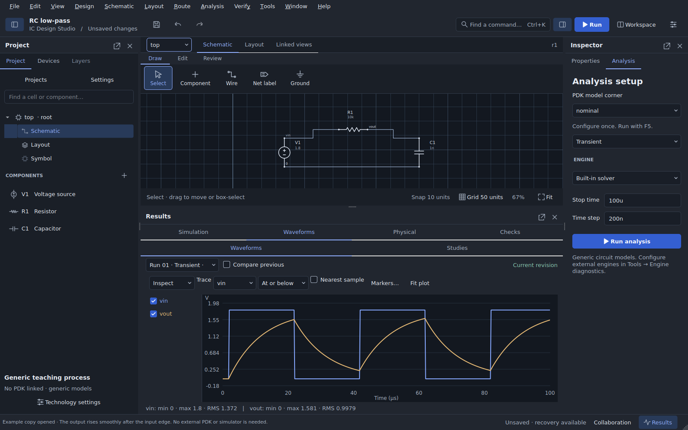

<p align="center">
  
</p>

<p align="center">
  <strong>An open desktop workspace for circuit design.</strong><br>
  Draw schematics. Optimize analog circuits. Simulate RTL and mixed-signal systems. Build layouts.<br>
  Keep your cells, sources, models, testbenches, layouts, and results in one project.
</p>

<p align="center">
  <a href="docs/RELEASE_STATUS.md"></a>
  <a href="docs/RELEASE_STATUS.md"></a>
  <a href="https://github.com/jonahsaunders/IC-Design-Studio/actions/workflows/build-desktop.yml?query=branch%3Amain"></a>
  <a href="LICENSE"></a>
</p>

[Download the desktop app](docs/DOWNLOADS.md) · [Examples](docs/FEATURE_TOUR.md#example-library) · [Feature tour](docs/FEATURE_TOUR.md) · [Documentation](docs/INDEX.md) · [Contribute](CONTRIBUTING.md)

<p align="center">
  <a href="docs/GETTING_STARTED.md">
    <picture>
      <source media="(prefers-color-scheme: light)" srcset="docs/images/readme/simulation-light.png">
      
    </picture>
  </a>
  <br>
  <sub>A real simulation in the native desktop. The README preview follows your light or dark theme.</sub>
</p>

> **Engineering preview · 0.23.1.** See the [release notes](docs/UPDATE_0.23.1.md) and [download guide](docs/DOWNLOADS.md) for the Windows installer, portable archive and Linux package. Use [release status](docs/RELEASE_STATUS.md) to match a published asset to its exact source and validation evidence.

## Start in three steps

1. **Launch Studio.** Choose a complete Windows/Linux desktop package from the [download guide](docs/DOWNLOADS.md), or use the source instructions below.
2. **Open a working circuit.** Choose **File → Start here / example gallery → Your first waveform → Open a copy**. The RC example needs no external simulator or PDK.
3. **Make your first change.** Press **F5**, inspect **Results → Waveforms**, change a component value, and run again. Save your project with **Ctrl+S**.

Want a guided course? Open the **Student Hub** tab for [115 illustrated lessons across eleven worlds](docs/STUDENT_HUB.md), from a first RC circuit to CMOS standard-cell design challenges and a sensor-acquisition capstone.

<details>
<summary><strong>Run from source</strong> · Python 3.12 · Windows, Linux and experimental macOS</summary>

**Windows:** install 64-bit Python 3.12 and Git, then run:

```powershell
git clone --branch main --single-branch https://github.com/jonahsaunders/IC-Design-Studio.git
cd IC-Design-Studio
.\launch-windows.bat
```

You can also extract the source to a short path such as `C:\ICStudio` and double-click `launch-windows.bat`. The launcher creates an isolated environment under `%LOCALAPPDATA%\ICStudio`, downloads and verifies the pinned ngspice runtime, and checks dependencies and a real simulation before opening the app.

**Linux / macOS:**

```sh
git clone --branch main --single-branch https://github.com/jonahsaunders/IC-Design-Studio.git
cd IC-Design-Studio
python3.12 -m venv .venv
source .venv/bin/activate
python -m pip install -r requirements.txt
python scripts/check_simulation_assets.py
python main.py
```

For SPICE analyses, install ngspice (`sudo apt install ngspice` on Ubuntu, `brew install ngspice` on macOS), then select it in **Tools → Engine diagnostics and paths** or set `ICSTUDIO_NGSPICE`. macOS is a source workflow awaiting qualification.

Python requirements do not install the digital engines, VGA assets or openEMS runtime. Use a complete desktop package for included tools, or follow the [digital source setup](docs/DIGITAL_FLOW.md), [VGA build](docs/VGA_PLAYGROUND.md#source-setup-and-desktop-packaging) and [openEMS guide](docs/OPENEMS.md). [Simulation setup](SIMULATION_SETUP.md) covers analog engine configuration.

</details>

## Explore the workspace

| Workflow | Start here |
| --- | --- |
| Analog | [Draw a schematic, run SPICE, and inspect a waveform](docs/ANALOG_WORKSPACE.md) |
| AI Assistant | [Explain a circuit or failed run and create a testbench](docs/AI_ASSISTANT.md) |
| Digital | [Simulate RTL and take a block through synthesis and layout](docs/DIGITAL_FLOW.md) |
| Mixed signal | [Connect a SPICE circuit to a Verilog controller](docs/MIXED_SIGNAL_SAR.md) |
| Physical design | [Explore layout, extraction, and verification](docs/FEATURE_TOUR.md#one-cell-both-views) |

## Example library

Open **File → Start here / example gallery** for 13 guided projects. Choose the RC circuit for a first run, or follow the GF180 Banba reference from its schematic through optimization and layout. [Browse the gallery](docs/FEATURE_TOUR.md#example-library) · [Banba project and results](examples/gf180-banba/README.md)

For tool requirements, screenshots, and the full feature reference, see the [feature tour](docs/FEATURE_TOUR.md). For development setup and pull-request checks, see [Contributing](CONTRIBUTING.md).
