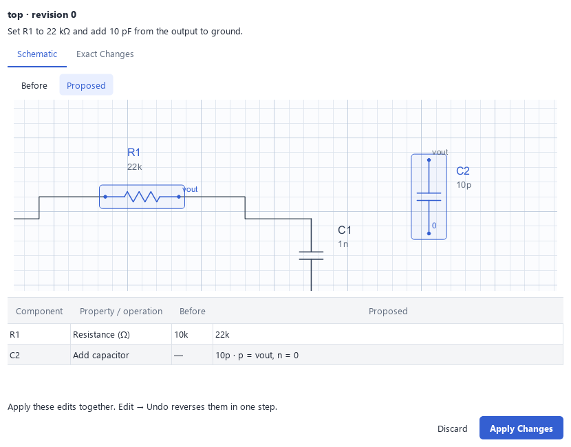
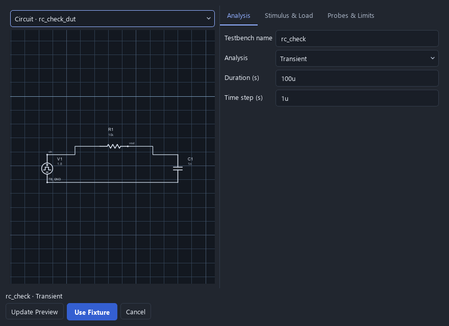
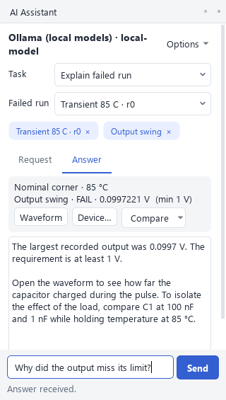

# AI Assistant

Open **Tools → AI Assistant…**, then **Options → Connection Settings…**. Choose a provider and enter a text model ID or deployment name available to your account. Studio remembers your model and endpoint on this computer. A key or access token entered in the dialog lasts for the current Studio session. The dialog also shows the environment variable you can set before starting Studio. Review the text in **Request**. Choosing **Send** shares that text with the selected provider.

## Try the RC example

### Change a selection

Select components or a wire in the schematic, then right-click the selection and choose **Request a Change…**. Shift-click to select several components. You can also choose **Change selected schematic** from **Tools → AI Assistant…**.

For example, select R1 and ask “Set R1 to 22 kΩ and add 10 pF from its output to ground.” **Send** opens a review when the provider returns a valid proposal. Switch between **Before** and **Proposed** to inspect the same area. Select a table row to highlight its component. Each row shows the original and proposed values or the new component and its terminal connections. **Exact Changes** shows the stored field differences, including any net label needed to attach a new part.

**Apply Changes** commits the entire preview in one undo step. **Discard** drops it. Closing the review lets you reopen it with **Review Changes…**. If the circuit revision changes, use **Options → Refresh Preview** to request a new proposal for the current selection.

The assistant can edit listed numeric component and source settings, including declared instance overrides. In Studio schematics it can also add a resistor, capacitor or inductor between selected scalar nets or ground. A wire selection supplies a connection point. A component selection also makes its editable fields available. Edits inside a shared cell definition affect its instances.

### Explain the circuit and build a testbench

1. Right-click R1 on the schematic and choose **Ask About This…**. Ask what sets the time constant. The **Request** tab shows the selected device and its pin connections. Choose **Send**, then enter a follow-up in **Question**.
2. Choose **Create a testbench**. Try “Run a transient analysis for 100 µs with a 200 ns step. Probe vin and vout and check that the final output is between 0 and 1.8 V.”
3. Inspect the schematic on the **Fixture** tab. Choose **Edit Fixture…** to adjust analysis settings, sources, loads, probes or measurement limits. If a draft identifies two possible outputs, click a highlighted pin or use the output selector in the editor.
4. Choose **Run Draft… → Run Draft** to simulate a temporary copy with ngspice. Inspect the waveform and measurements. **Save Testbench** adds the fixture to your design and **Edit → Undo** removes that addition in one step.

A circuit with exposed ports gets a fixture linked to the original circuit. Select a single subcircuit instance to target its circuit definition. For a simple, flat schematic with internal sources and no ports, Studio makes an editable snapshot for the fixture. Later edits to the original standalone circuit require a new snapshot. The preview identifies which form you are adding. Supported analyses are operating point, transient and AC. Fixtures can provide DC or pulse voltage sources, ground connections, resistive or capacitive loads, voltage probes and optional measurement limits.

## Explain a failure

Right-click a measured requirement in the results table, saved-run inspector or test-plan matrix and choose **Ask About This…**. You can also start from a waveform, an operating-point device, or a run in the simulation queue. **Explain failed run** lists interrupted jobs and completed runs that missed a measured requirement.

The **Answer** tab shows the recorded value, target and available operating conditions. **Waveform** opens the saved trace for that requirement. **Device…** opens the saved operating-point view. Under **Compare**, choose **Compare with Passing Run…** to overlay a compatible passing result for the same measurement definition. Both runs retain their own revision and condition labels.

Ask a follow-up such as “Did this also fail at room temperature?” The request includes matching recorded conditions and recent questions and answers. Attachments identify the circuit revision and selected evidence. They stay pinned as you navigate. Select an attachment’s × to remove it and clear the preceding conversation from subsequent requests. **Options → New Investigation** starts over from the current workspace.

This example uses the RC simulator's recorded maximum of 0.0997 V and a scripted assistant response.

### Compare one change

Choose **Compare → Compare One Change…** from the answer. Review the parameter, baseline and proposed value, or enter your own. For a missing room-temperature run, choose **Temperature (°C)** and enter **27**. **Run Both** simulates the saved baseline and a copy with that one change. Compare their traces and the change in measured values. **Keep Variant…** saves the modified copy as a separate editable project. **Discard Variant** closes the comparison. Completed runs remain available in the simulation history.

## Connections

| Provider | What to enter |
| --- | --- |
| OpenAI, Anthropic Claude, Google Gemini, Meta, xAI Grok, Mistral, Cohere, DeepSeek | A text model ID and API key for the selected provider. |
| Moonshot Kimi, Z.ai GLM, Baidu Qianfan, NVIDIA, Groq, Perplexity | A model ID from the selected service and its API key. Perplexity uses Agent API model IDs. |
| Alibaba Qwen | Your workspace's regional API base ending in `/compatible-mode/v1`, its key and model ID. |
| Microsoft Azure OpenAI | Your resource URL ending in `/openai/v1`, deployment name and resource API key. |
| Amazon Bedrock | The regional Bedrock runtime URL, model or inference profile ID and a Bedrock bearer API key. Use a model that supports Converse. |
| Google Cloud Vertex AI | The Gemini model collection URL ending in `/v1/projects/PROJECT/locations/LOCATION/publishers/google/models`, publisher model ID and a current OAuth access token. The global host is `aiplatform.googleapis.com`. Regional hosts begin with `LOCATION-aiplatform`. |
| Ollama | Start the local server and enter an installed text model ID. Studio defaults to `http://127.0.0.1:11434/v1`. This also works with locally installed Llama models. |
| OpenAI-compatible endpoint | Enter the server's API base URL, chat model ID and optional key. HTTPS is required for remote hosts. HTTP is supported on loopback. |

Provider setup references include [OpenAI](https://developers.openai.com/api/docs/quickstart), [Claude](https://platform.claude.com/docs/en/api/messages/create), [Gemini](https://ai.google.dev/gemini-api/docs/openai), [Meta](https://dev.meta.ai/docs/cookbook/quickstart-chat-completions), [Perplexity](https://docs.perplexity.ai/docs/agent-api/models), [Qwen](https://www.alibabacloud.com/help/en/model-studio/compatibility-of-openai-with-dashscope), [Azure](https://learn.microsoft.com/en-us/rest/api/aifoundry/azureopenai/chat), [Bedrock](https://docs.aws.amazon.com/bedrock/latest/userguide/api-keys-use.html), [Vertex AI](https://cloud.google.com/vertex-ai/generative-ai/docs/start/gcp-auth) and [Ollama](https://docs.ollama.com/api/openai-compatibility).

The inspector uses grouped commands, contextual actions, keyboard-accessible controls and an explicit review step before making design changes. The interface follows Apple's guidance on [menus](https://developer.apple.com/design/human-interface-guidelines/menus), [context menus](https://developer.apple.com/design/human-interface-guidelines/context-menus), [panels](https://developer.apple.com/design/human-interface-guidelines/panels) and [generative AI](https://developer.apple.com/design/human-interface-guidelines/generative-ai). The design also draws on the component-linked conversation and visual change review in [Backplane's CAD workspace](https://github.com/BackplaneWorks/Backplane#cad).

The desktop tests use a local HTTP service for provider responses and real Studio simulation jobs for draft and comparison results. They exercise saved-revision navigation, follow-up questions, output selection, fixture edits, cancellation, separate variant projects and undo. Adapter tests cover the request and response formats for every listed connection. These checks support UX-02, UX-10 and EXP-01.
