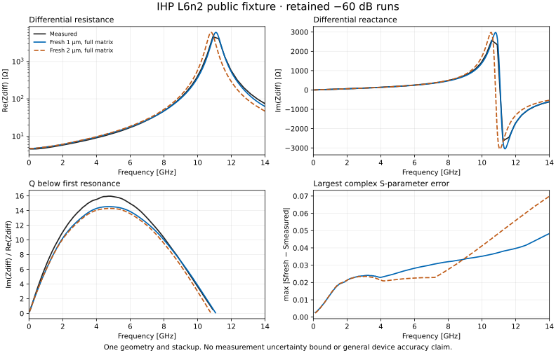

# Measured IHP coil reference

The repository retains a public measured L6n2 coil, its exact layout and two
independent solvers' published responses. These provide a concrete reference
for investigating IHP EM accuracy. They do not qualify a different generated
coil, every IHP inductor, or a complete operating envelope.

The inputs are unmodified files from
[`VolkerMuehlhaus/openems_ihp_sg13g2`](https://github.com/VolkerMuehlhaus/openems_ihp_sg13g2/tree/0f87e9d069de3e88bdfdc5bb30d4a0958f045d32/more_examples/measured_vs_simulated/more_accurate_models_L6n2),
commit `0f87e9d069de3e88bdfdc5bb30d4a0958f045d32`, under GPL-3.0. The fixture
directory `tests/fixtures/ihp-measured-coil-v1` includes the original license and
study. `SOURCE.json` records every original path, Git blob identity and SHA-256;
only local filenames are shortened. This newer reference has its own license
and identity, separate from the older bundled Apache-2.0 material profiles.

Run the portable audit with:

```sh
python scripts/audit_ihp_measured_reference.py --output reference-audit.json
```

Add `--exchange-output new-folder` to exercise ordinary application import,
project save/reopen and GDS/OASIS export. Independent physical-coordinate XOR
checks preserve every mask, including all vias, both port rectangles and the
reference conductor when normalizing the original 5 nm database to 1 nm.
Written text and anchors are compared directly. GDS retains native text
presentation; OASIS appearance uses optional property 124, independently checked
against its written anchor. Other tools may discard that optional appearance.

It authenticates the complete fixture and independently converts full complex
S matrices into Z matrices using NumPy. It checks the application's differential
impedance conversion and largest-scattering-gain calculation against independent
matrix operations. Resistance, inductance, peak Q below first resonance, and
self-resonance reproduce the rounded values in the original study. Full complex
response differences are reported over 0.1–14 GHz using explicit interpolation
and no extrapolation. A phase error cannot pass merely because magnitudes match.
Measurement uncertainty is not supplied as an acceptance bound; the report
does not turn these differences into an accuracy certificate.

The source study models a four-turn TopMetal2 coil with TopMetal1 underpasses
and TopVia2 arrays. Its explicit fixture uses a 200 µm stack, substrate-surface
PEC reference, two vertical ports, finite via conductivity corrected for merged
array fill, and a reduced planar passivation profile. The study compares its
1 µm and 2 µm meshes at a −60 dB stopping criterion. Reproduction must retain
these assumptions and record every local modification. The original workflow
is supplied as source material; the portable audit does not execute it or
install its optional solver dependencies.

The seven regression tests exercise source tampering, malformed/nonfinite
data, duplicate frequencies, phase-only faults, resistance faults and missing
frequency/reference-impedance coverage, plus real geometry exchange with a
missing-via and a moved-label control. The public reference audit remains
separate from fresh native execution and from application device qualification.

## Reproduce the native reference

`scripts/run_ihp_measured_coil.py` stages the pinned public workflow and runs
each excitation in its own native process. This avoids the Windows openEMS
0.0.36 heap corruption observed when the upstream script reused an FDTD object
for the second CSX setup. The runner selects four threads, one published mesh
and the −60 dB energy target, preserves Windows path case, and reads both probe
columns only after both processes finish. Geometry, stackup, via fill correction,
pulse, boundaries and mesh generation retain their upstream definitions.

Use an isolated openEMS Python with NumPy, gdspy and Shapely available. The
retained execution uses openEMS 0.0.36, CSXCAD 0.6.3, NumPy 1.23.5, gdspy 1.6.13
and Shapely 2.0.7. Solver dependencies are separate from the application Python.
Optional `--dependency-path` arguments add existing isolated package folders;
the runner does not install packages or change the solver environment on disk.

```sh
python scripts/run_ihp_measured_coil.py --mesh-um 2 --output new-coarse-run --python /path/to/openems/python
python scripts/run_ihp_measured_coil.py --mesh-um 1 --output new-fine-run --python /path/to/openems/python
python scripts/run_ihp_measured_coil.py --mesh-um 2 --audit-existing new-coarse-run --output new-readback.json
```

Add `--prepare-only` and omit `--python` to inspect staged inputs without running
the solver. Each output folder must be new. Native failures, timeouts and changed
inputs fail the run; logs and execution records remain available. A completed
process must reach −60 dB and print the expected native completion markers.
Long Windows destinations are rejected before the upstream utility can redirect
them into a shared temporary directory and reuse another run's files.

Readback independently transforms the original voltage/current samples and
checks the application's full incident-matrix calculation against direct matrix
algebra. It reports both the original workflow's column-normalized conversion
and the full-matrix result against measured and published solver responses.
Original time offsets are retained; probe coordinates must be finite, explicitly
in metres, and identical across excitations. No de-embedding is inferred from
that position check. A successful readback establishes consistent arithmetic,
not a tolerance on measured accuracy or a replacement for missing compact models.

New runs hash all four native probe outputs when each excitation completes.
Readback requires those original bytes. Historical records without these output
hashes need the explicit `--allow-legacy-unbound-probes` acknowledgement; their
reports mark that provenance limit instead of inventing execution-time hashes.
The original October 21 research wrappers have this historical limitation.

Each JSON readback also writes a checksum-bound `.s2p` containing the full complex
matrix at positive frequencies, with its 50 Ω reference and explicit fixture
identity. It preserves phase and port order and can be inspected in other tools;
it is not automatically attached to a different application coil.

Nine runner tests cover source and geometry changes, unexpected modules, native
completion/energy faults, timeouts, and an independent coherent sine/cosine
Fourier reference with unit, nonfinite-coordinate and time-grid faults, plus
complex response export, overwrite protection, Windows path fallback, changed
probe bytes and a successful process exit with missing probe outputs.
The Windows-only path-fallback test is explicitly skipped on Linux. CI runs
these inexpensive checks; it does not describe them as a fresh field solve.

## Completed October 21 reproduction

The [execution record](validation/ihp-measured-coil-2026-10-21.json) retains
four completed native excitations at 1 µm and 2 µm mesh sizes. All reach the
unchanged −60 dB energy target. Independent Windows/Linux readback compares the
raw voltage/current transforms with unrounded native CalcPort output, full
incident-matrix algebra and the application's conversion. Both networks pass
sampled passivity. The original seven-digit writer's quantization is checked
separately instead of weakening the arithmetic tolerance.

| Response | R at 1 GHz (Ω) | L at 1 GHz (nH) | Peak Q | First resonance (GHz) |
| --- | ---: | ---: | ---: | ---: |
| Measured | 4.86089 | 5.00887 | 15.9567 | 11.06974 |
| Fresh 1 µm, full matrix | 5.13148 | 4.81240 | 14.5333 | 11.08346 |
| Fresh 2 µm, full matrix | 5.14567 | 4.80502 | 14.2920 | 10.79996 |

The table is a comparison, not an accuracy acceptance test. Across 0.1–14 GHz,
the maximum complex S-parameter and relative impedance errors against the
measurement are:

| Mesh | max absolute S error | max relative Z error | max relative R error |
| --- | ---: | ---: | ---: |
| 1 µm | 0.048303 | 39.52% | 39.56% |
| 2 µm | 0.069911 | 89.70% | 119.99% |

The two fresh meshes themselves differ by up to 106.99% in complex impedance and 187.56% in resistance over that full band (coarse response denominator). Completed execution and agreement with each published mesh do not imply full-band mesh convergence.

The large full-band errors near resonance remain visible. Source measurement
uncertainty is unspecified; these results do not establish a general model
accuracy bound or qualify another coil geometry. The exact published simulation
comparisons and their interpolation conventions are in the execution record.



Portable full-complex responses are retained for the
[fine mesh](qualification/ihp-measured-coil-2026-10-21/native-fine.s2p) and
[coarse mesh](qualification/ihp-measured-coil-2026-10-21/native-coarse.s2p).
Both use 50 Ω reference impedance and preserve phase and port order. They are
geometry-specific research results and are not default compact inductor models.

The archive preserves completed and failed attempts, exact solver/dependency
identities, source snapshots and all raw probes. Every archived object is
verified, and restoring only the necessary inputs reproduces both responses on
Windows and Linux. Historical wrappers lack execution-time probe hashes; that
limitation remains explicit. New runner executions bind the probe bytes at
completion. The final source suites pass 3,248 tests per host, with 63 Windows
and 56 Linux skips. Remaining models, full operating envelopes, broader physical
coverage and final installed-source acceptance still keep chunk 7 open.
