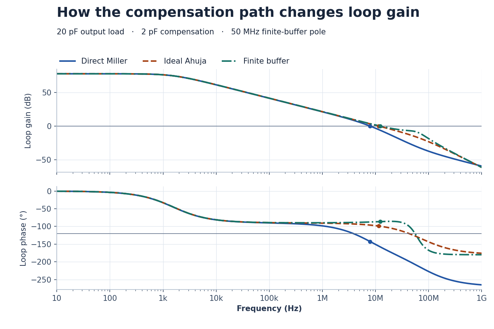

# Ahuja compensation for op amps

Open **Student Hub → Analog design projects → Ahuja compensation for op amps**.
Inspect the editable SKY130 Miller reference, then choose **Open loop
comparison** for the interactive small-signal experiment.

## Why the direct capacitor matters

The first gain stage drives the inverting second stage. A capacitor across
that second stage returns current to the first-stage node and helps split
the poles. The same capacitor also carries feedforward current from the
first stage directly to the output, bypassing the second-stage inversion.
In the basic model, the loop-gain numerator contains `gm₂ − sCc`. Its
right-half-plane (RHP) zero is near `fz = gm₂/(2πCc)`.

Both RHP and left-half-plane zeros turn the magnitude slope upward. The
RHP factor `1 − j f/fz` also adds phase lag. When unity-gain crossover
moves toward this zero or a nondominant pole, the lost phase margin can
increase ringing or cause instability. A series Miller nulling resistor
near `1/gm₂` can move this elementary zero to very high frequency. Its
movement and the remaining poles depend on the circuit.
[Ahuja’s original small-signal analysis](https://milindsweb.amved.com/docs/Ahuja_Compensation_Paper.pdf)

## How the current buffer changes the loop

In the ideal Ahuja equivalent, `Cc` connects from the output to a
low-impedance AC node. The buffer copies the capacitor current back to the
high-impedance first-stage node. This retains compensation feedback and
removes the direct first-stage-to-output capacitive feedforward path.
A common-gate stage is one way to implement the current input. Its
bias, bandwidth, headroom and parasitics matter.

The teaching comparison uses identical stage parameters and a 2 pF
compensation capacitor. For the direct Miller model, the example RHP zero
is near 79.6 MHz. The ideal Ahuja model removes that numerator zero. The
third curve keeps the input at virtual AC ground and adds one pole to the
copied current. This isolates a finite buffer bandwidth effect.

For a hand calculation, let `Y₁ = 1/R₁ + sC₁` and
`Y₂ = 1/R₂ + s(CL + Cc)`. With an ideal current copy, the positive DC
return ratio is `gm₁ gm₂/(Y₁Y₂ + sCc gm₂)`. In the finite-buffer
experiment replace the copied branch term `sCc gm₂` with
`sCc gm₂/(1 + s/ωb)`. The model uses `gm₁ = 150 µS`, `gm₂ = 1 mS`,
`R₁ = 500 kΩ`, `R₂ = 100 kΩ` and `C₁ = 0.2 pF`.

## Read unity gain and phase margin

In the Lesson Guide, open **Compare loop response** and use **Save comparison**
for the two buffer bandwidths at both capacitive loads. The checkpoint uses
the resulting unity frequency and phase margin recorded in the lesson project.

1. Set a 20 pF load and 50 MHz buffer pole. Draw 0 dB across the gain
   chart. For each curve, line up its first falling crossing with its own
   phase. For the positive low-frequency return ratio `T` and unity
   negative feedback, `PM = 180° + ∠T` at that crossing.
2. Compare against the 60° exercise target. The direct Miller model
   crosses near 7.93 MHz with 37.4° margin. The ideal Ahuja model crosses
   near 11.53 MHz with 81.2° margin under the same load.
3. Lower the buffer pole to 10 MHz. The finite-buffer curve now crosses
   near 38.8 MHz with only about 16.1° margin. Try 2 pF and 50 pF as
   well. Read each curve’s crossing again after changing the load.
4. In a transistor implementation, check all relevant loop crossings,
   load and feedback conditions, process, voltage, temperature, and
   transient settling. Budget bias and voltage headroom for the buffer.
   Keep the high-impedance stage connection short and inspect the buffer
   node and supply paths after extraction. Run a separate supply-ripple
   injection to measure PSRR. The paper demonstrates a particular
   implementation’s supply rejection. This classroom study models loop
   gain and phase only.
