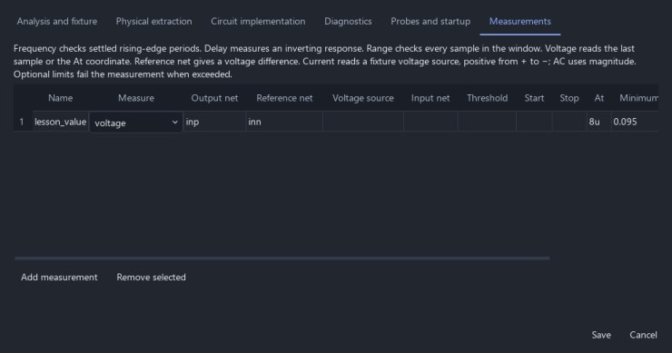

# Engineering design labs

Open **Student Hub** and select the world shown in the table. Each lesson
has an editable starter, a guided walkthrough, a do-it-yourself mode,
and a worked solution. The walkthrough shows pictures from the current
workspace. Run the starter first to see which constraint drives the edit.

| World | Level | Lesson | Passing measurement |
| --- | --- | --- | --- |
| Foundations | Easy | Measure a voltage that isn’t referenced to ground | Read 0.30 V across the component within 5 mV, with the meter referenced to its lower terminal. |
| Foundations | Medium | Turn an open-drain output into a usable signal | Reach 70% of the 1.8 V supply within 0.8 µs, hold low at or below 0.20 V, and keep sink current at or below 0.50 mA. |
| Analog | Easy | Keep a transistor switch fully on | Limit on-state drop to 0.15 V at both loads with gate drive at or below 1.8 V. Verify off-state isolation. |
| Analog | Medium | Design a buffer for a weak sensor | Keep sensor loading and output error to 1% each. Settle the step within 1.5 µs with the supplied capacitive load. |
| Analog Design Projects | Medium | Build a two-threshold window detector | Keep both sweep directions within 20 mV of the 0.55 V and 1.25 V boundaries. Verify valid levels inside and outside the band. |
| Analog Design Projects | Hard | Build a switched-capacitor gain stage | Meet a gain of 2 within 2%, settle both levels within 5 mV by 0.7 µs into transfer, and limit hold change to 2 mV. |
| Analog Design Projects | Hard | Design a tunable gm-C filter | Meet 20 kHz and 60 kHz cutoffs within 6% with the same capacitor. Keep both low-frequency gains from 0.98 to 1.02 and THD on the 5 kHz tone at or below 1%. |
| Digital | Medium | Build an SPI register peripheral | Read and write four registers in Mode 0. Reject short, long, and invalid-address writes. Hold MISO stable while the clock is high and release it on deselect. |
| Layout | Medium | Route the sensitive plate of a MIM capacitor | Preserve the model-linked 10 × 10 µm body and plate connections. Bring added sense-route capacitance to 0.55 fF or less. |
| Layout | Medium | Place decoupling where it reduces droop | Keep the 200 pF capacitor, reconnect its supply and return branches, and meet 25 mV during the 0.8 ns pulse in the layout-derived RC model. |
| Testbenches | Medium | Build a balanced differential stimulus | Produce ±0.10 V differential at 0.90 V common mode and reproduce the reading in a graphical fixture or a SPICE program. |
| Standard Cells | Hard | Lay out a half-adder with shared logic | Finish the supply, sum, and carry routes. Pass both truth tables, fit within 106.6 µm, and meet the 350 ps sum and 210 ps carry limits. |
| Standard Cells | Medium | Build a Schmitt-trigger input | Measure at least 0.80 V hysteresis. Keep the lower threshold at or above 0.40 V and the upper threshold at or below 1.40 V. |
| Standard Cells | Hard | Build a tri-state bus driver | Check both driven and both released output levels. Meet 165 ps driven rise delay and 0.10 µA released-bus current, with no simultaneous enable at handoff. |

## How the measurements work

**Circuit labs.** The switched-capacitor lab uses two nonoverlapping clocks,
voltage-controlled switches, and a finite-gain amplifier model. The gm-C lab
uses a tunable OTA model and measures the resulting AC response at both bias
settings. The sensor-buffer and window labs use functional buffer and
comparator models so the checkpoints focus on the external design targets.

**Layout labs.** The MIM lab estimates the ground capacitance added by the
drawn access metal, separately from the active capacitor body. The
decoupling lab computes branch resistance from both drawn routes and uses it
in a teaching RC model with a fixed source impedance and pulse load.

**Standard cells.** Studio uses SKY130 transistor models for the schematic and
layout-loaded comparisons. The layout case adds the exercise’s lumped
metal-to-ground capacitance estimate. The half-adder results show both
outputs at each input vector. The Schmitt-trigger results show the two
input voltages at the output crossings. In the tri-state fixture, a weak
bias probes whether the released output follows both logic levels before a
second driver takes over.

**Differential fixture.** The graphical measurement subtracts the reference
net from the output net. The SPICE version captures the same difference
from both input traces. The checkpoint also checks the average of those
two traces before and after the transition.

