# Student Hub

Open the **Student Hub** tab beside **Design** in IC Design Studio. The Hub has **115 distinct lessons across eleven worlds**, including eight CMOS inverter stages that repeat for each supported PDK revision. Choose **Map** to explore the worlds or **List** to browse them. Both views share your progress, search, and lesson prerequisites. Filter by Easy, Medium, or Hard in either view.

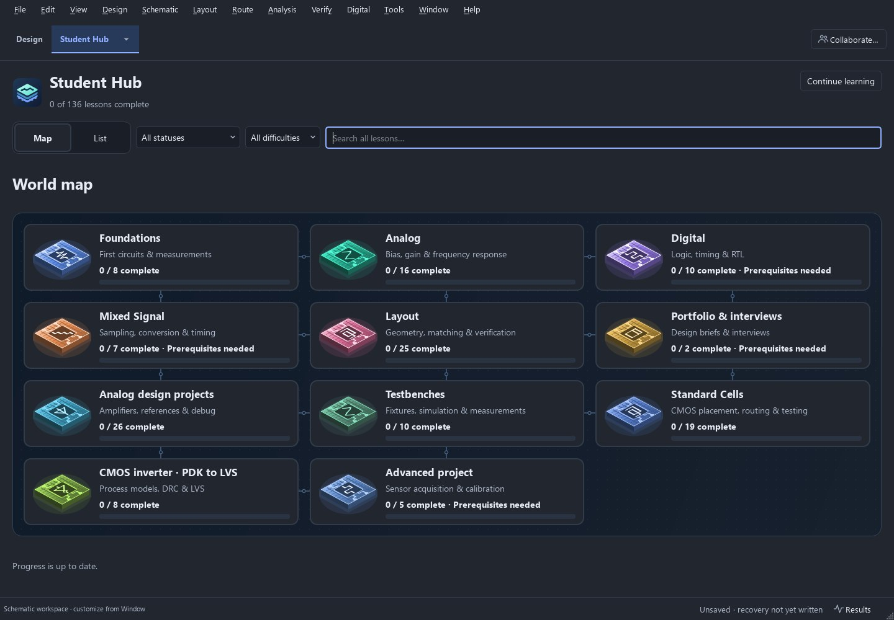

[Browse the lessons](#learning-paths) · [Work through a lesson](#learn-beside-the-real-editor) · [Get unstuck](#help-and-solutions) · [Set up simulation engines](#engines-and-models)

## Learning paths

Jump to a world to see every lesson in it. Select an image to open the full-size screenshot. The pictures show Studio's real schematics, layout views, RTL editors, and lesson controls at representative checkpoints.

[Foundations](#foundations) · [Analog](#analog) · [Digital](#digital) · [Mixed Signal](#mixed-signal) · [Layout](#layout) · [Portfolio & interviews](#portfolio--interviews) · [Analog design projects](#analog-design-projects) · [Testbenches](#testbenches) · [Standard Cells](#standard-cells) · [CMOS inverter](#cmos-inverter--pdk-to-lvs) · [Advanced project](#advanced-project)

### Foundations

| Screenshot | Lesson |
| --- | --- |
| [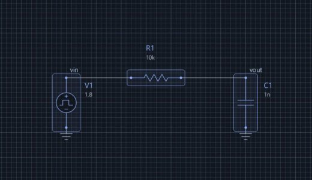](images/student-hub/f-first.jpg) | **01 · Your first measured circuit**. *Easy*. Inspect a source, resistor and capacitor; predict the time constant and verify a transient. |
| [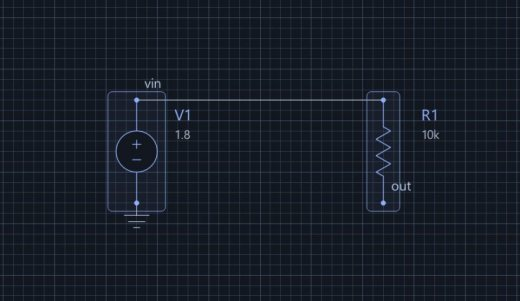](images/student-hub/f-connect.jpg) | **02 · Nets, ground and loading**. *Easy*. Complete a divider by placing and connecting the lower resistor, then verify its output. |
| [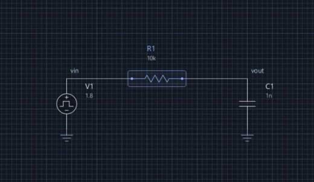](images/student-hub/f-edit.jpg) | **03 · Change, compare and undo**. *Easy*. Make a deliberate parameter change and prove its effect using a new result. |
| [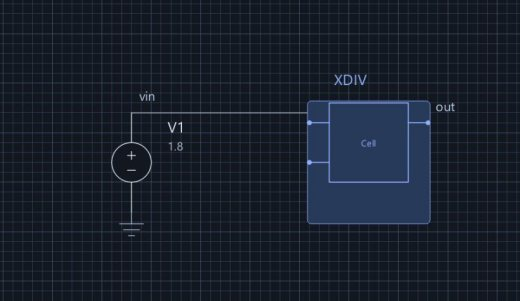](images/student-hub/f-hierarchy.jpg) | **04 · Reusable cells and hierarchy**. *Easy*. Inspect a two-resistor cell instantiated in a testbench. |
| [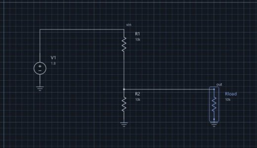](images/student-hub/f-debug.jpg) | **05 · Requirements and debugging**. *Easy*. Distinguish a successful simulator run from meeting a design requirement. |
| [](images/student-hub/f-portfolio.jpg) | **06 · Layout, checks and reproducibility**. *Medium*. Inspect geometry, understand evidence limits, and preserve a reproducible learning record. |


### Analog

| Screenshot | Lesson |
| --- | --- |
| [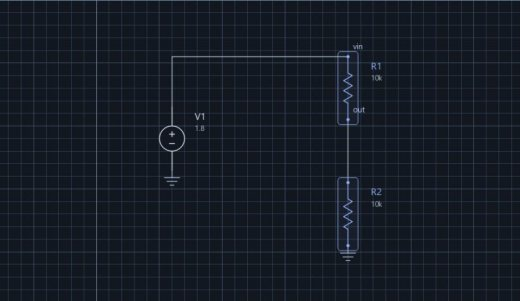](images/student-hub/a-load.jpg) | **01 · Design around source and load**. *Easy*. Model loading explicitly before adding gain. |
| [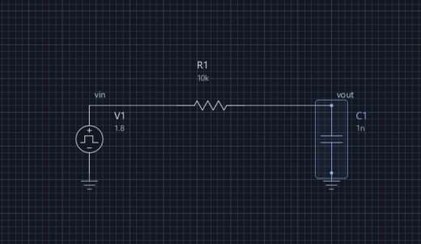](images/student-hub/a-bandwidth.jpg) | **02 · Set bandwidth with an RC pole**. *Easy*. Choose capacitance for a target bandwidth and verify the AC response. |
| [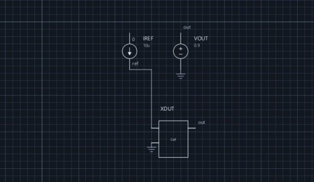](images/student-hub/a-bias.jpg) | **03 · Scale a current mirror**. *Medium*. Use geometry ratios to set bias current and inspect the operating point. |
| [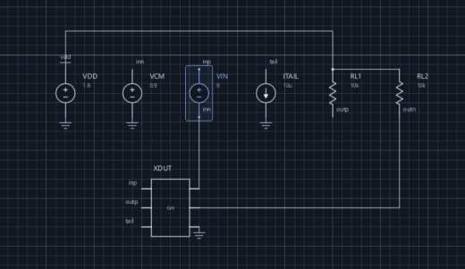](images/student-hub/a-differential.jpg) | **04 · Steer a differential pair**. *Medium*. Apply a small differential input and follow the change in branch voltages. |
| [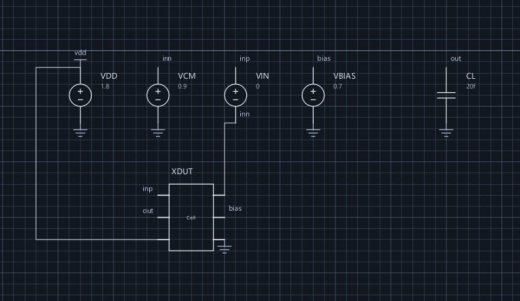](images/student-hub/a-amplifier.jpg) | **05 · A five-transistor amplifier**. *Medium*. Combine bias, differential input and active load, then measure small-signal gain. |
| [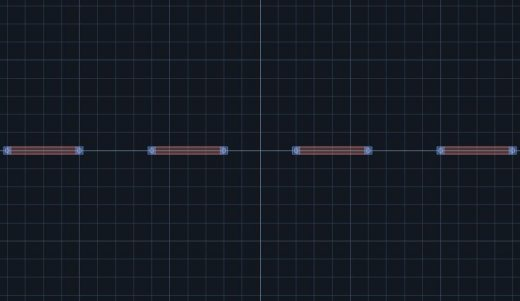](images/student-hub/a-layout.jpg) | **06 · Matching and physical tradeoffs**. *Medium*. Inspect common-centroid geometry and plan a credible analog implementation. |
| [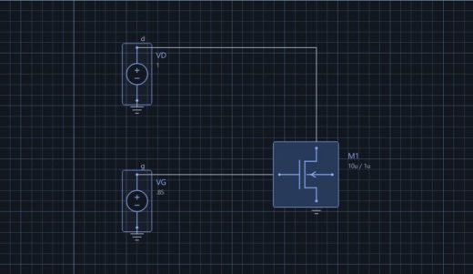](images/student-hub/a-gmid-bias.jpg) | **07 · Understand gm/ID and choose a bias**. *Medium*. Measure transconductance efficiency and connect gate bias to current, gain and headroom. |
| [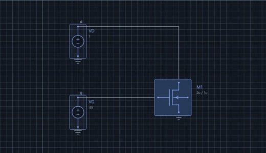](images/student-hub/a-gmid-size.jpg) | **08 · Turn a gm target into device width**. *Medium*. Work from a transconductance requirement to bias current and width, then verify the operating point. |
| [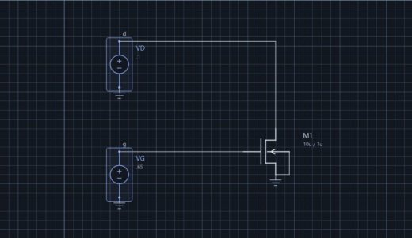](images/student-hub/a-gmid-headroom.jpg) | **09 · Budget voltage headroom**. *Medium*. Repair a bias point that loses saturation and explain output swing constraints. |
| [](images/student-hub/a-gmid-tradeoff.jpg) | **10 · Compare efficiency, area and speed**. *Hard*. Meet the same gm target at lower current and identify what the simple model cannot tell you. |
| [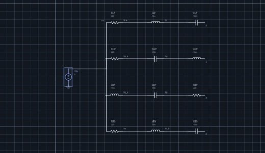](images/student-hub/a-lc-bode.jpg) | **LC filters and Bode plots**. *Medium*. Hand-sketch, simulate and tune low-pass, high-pass, band-pass and notch responses on one editable RLC bench. [Guide](STUDENT_LC_BODE.md). |
| [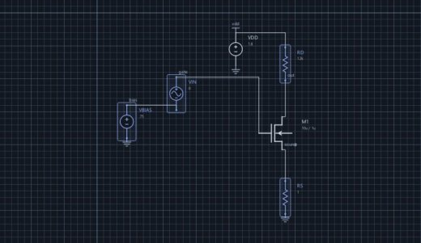](images/student-hub/a-degeneration.jpg) | **Trade gain for linearity**. *Medium*. Add source degeneration to a MOS stage, restore its bias and compare measured gain and distortion. [Guide](STUDENT_SIGNAL_LABS.md). |
| [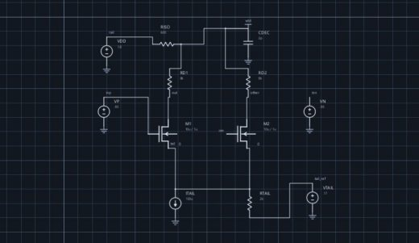](images/student-hub/a-rejection.jpg) | **Measure PSRR and CMRR**. *Hard*. Use separate differential, common-mode and supply excitations to find and fix two disturbance paths. [Guide](STUDENT_SIGNAL_LABS.md). |
| [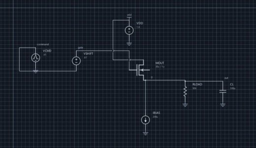](images/student-hub/a-drive.jpg) | **Drive a difficult load**. *Hard*. Compare a simple source follower and a feedback buffer under identical capacitive loads. [Guide](STUDENT_SIGNAL_LABS.md). |


### Digital

| Screenshot | Lesson |
| --- | --- |
| [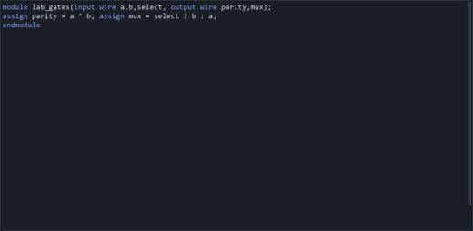](images/student-hub/d-logic.jpg) | **01 · Truth tables and combinational RTL**. *Easy*. Enumerate the complete truth table for XOR and a two-input mux. [Guide](DIGITAL_WORKSPACE.md). |
| [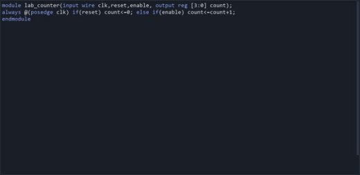](images/student-hub/d-counter.jpg) | **02 · Clock, reset and enable**. *Easy*. Verify reset, hold, increment and four-bit wraparound. [Guide](DIGITAL_WORKSPACE.md). |
| [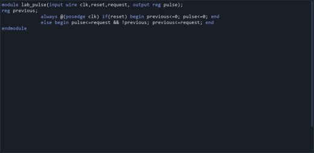](images/student-hub/d-pulse.jpg) | **03 · State and one-cycle handshakes**. *Easy*. Turn a held request into a single clock-wide pulse. [Guide](DIGITAL_WORKSPACE.md). |
| [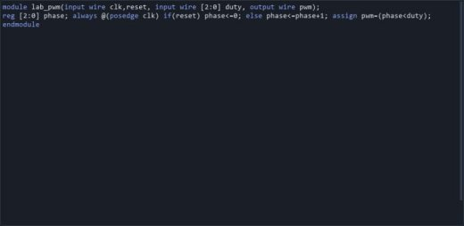](images/student-hub/d-pwm.jpg) | **04 · Counters as waveform generators**. *Medium*. Sweep duty settings and count actual high cycles in each eight-clock frame. [Guide](DIGITAL_WORKSPACE.md). |
| [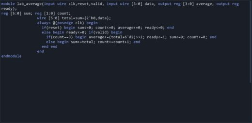](images/student-hub/d-average.jpg) | **05 · Fixed-point arithmetic and valid data**. *Medium*. Accumulate four samples without overflow and round the result. [Guide](DIGITAL_WORKSPACE.md). |
| [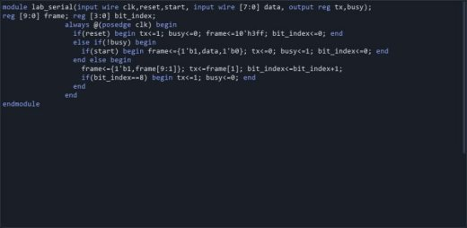](images/student-hub/d-serial.jpg) | **06 · A verified serial transmitter**. *Medium*. Frame bytes with start/stop bits, capture the payload and handle reset. [Guide](DIGITAL_WORKSPACE.md). |
| [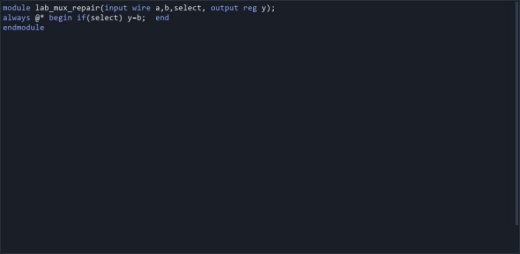](images/student-hub/d-latch.jpg) | **07 · Repair unintended combinational memory**. *Medium*. Fix an incomplete combinational assignment and prove the output depends only on current inputs. |
| [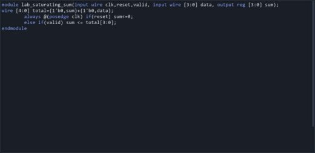](images/student-hub/d-saturation.jpg) | **08 · Repair arithmetic overflow**. *Medium*. Define an arithmetic contract and repair a four-bit saturating accumulator. |
| [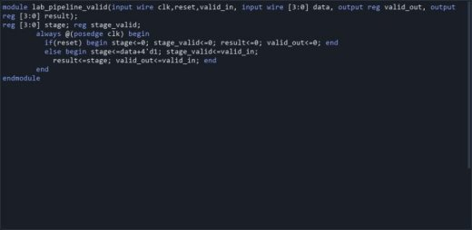](images/student-hub/d-pipeline.jpg) | **09 · Align data and valid through a pipeline**. *Hard*. Repair a one-cycle validity mismatch and reason about bubbles, reset and timing. |


### Mixed Signal

| Screenshot | Lesson |
| --- | --- |
| [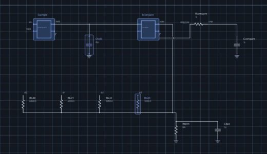](images/student-hub/m-bridge.jpg) | **01 · Cross the analog/digital boundary**. *Easy*. Follow the clocked bridge from comparator voltage to RTL decisions and back to DAC voltages. [Guide](MIXED_SIGNAL_SAR.md). |
| [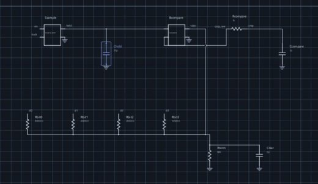](images/student-hub/m-hold.jpg) | **02 · Acquire, then hold**. *Easy*. Change the input during conversion and verify the held sample is used. [Guide](MIXED_SIGNAL_SAR.md). |
| [](images/student-hub/m-codes.jpg) | **03 · Quantization and code transitions**. *Medium*. Predict a new output code and verify an edited stimulus. [Guide](MIXED_SIGNAL_SAR.md). |
| [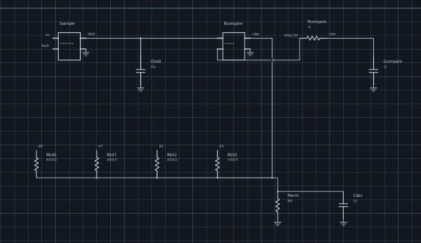](images/student-hub/m-settling.jpg) | **04 · Repair a timing failure**. *Hard*. A deliberately fast clock produces a wrong conversion; restore enough settling time. [Guide](MIXED_SIGNAL_SAR.md). |
| [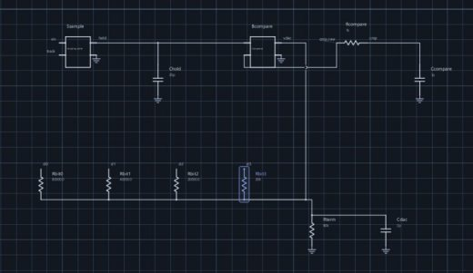](images/student-hub/m-weight.jpg) | **05 · Repair a DAC weight**. *Medium*. Use a numerical requirement to locate and repair a wrong resistor. [Guide](MIXED_SIGNAL_SAR.md). |
| [](images/student-hub/m-repeat.jpg) | **06 · Repeated conversions**. *Medium*. Verify two acquisitions in one analog history and inspect the start/busy/done contract. [Guide](MIXED_SIGNAL_SAR.md). |
| [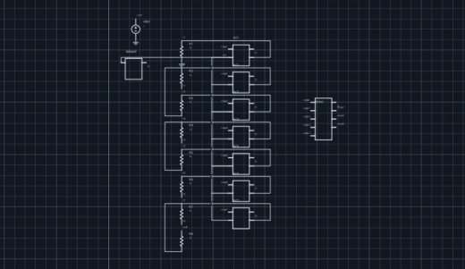](images/student-hub/m-ramp.jpg) | **Characterize an ADC with a ramp**. *Hard*. Sample an actual flash ADC ramp response, measure DNL and INL and recover a collapsed code bin. [Guide](STUDENT_SIGNAL_LABS.md). |


### Layout

| Screenshot | Lesson |
| --- | --- |
| [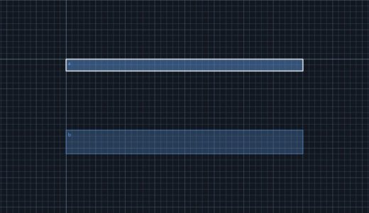](images/student-hub/l-width.jpg) | **01 · Repair a minimum-width violation**. *Easy*. Learn layout units and repair a metal route using measured geometry. |
| [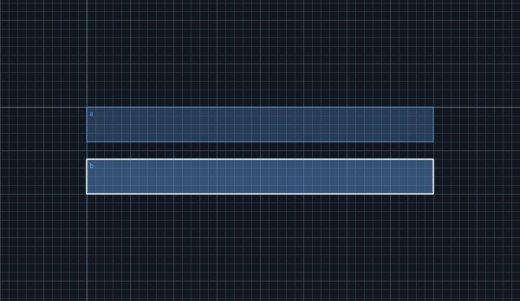](images/student-hub/l-spacing.jpg) | **02 · Separate neighboring routes**. *Easy*. Measure edge-to-edge spacing and repair a pair of adjacent nets. |
| [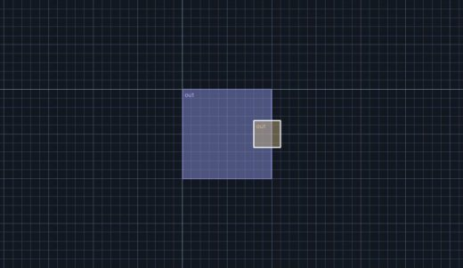](images/student-hub/l-via.jpg) | **03 · Enclose a via on both metals**. *Easy*. Repair a via landing and distinguish geometric overlap from connectivity verification. |
| [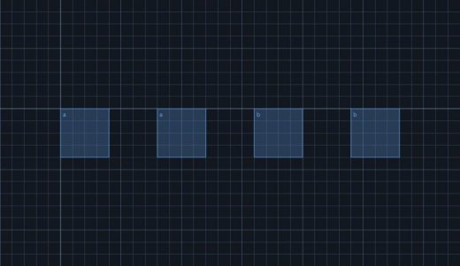](images/student-hub/l-centroid.jpg) | **04 · Build a common-centroid pattern**. *Medium*. Rearrange equal unit tiles to cancel a first-order spatial gradient. |
| [](images/student-hub/l-layout-decisions.jpg) | **Why layout choices matter**. *Hard*. Fix via enclosure and matching, find a geometry-clean open, then improve the actual bandwidth of an RC route. [Guide](STUDENT_LAYOUT_DECISIONS.md). |
| [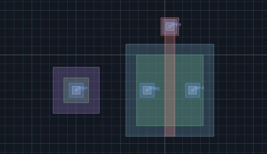](images/student-hub/l-fold.jpg) | **Fold a MOSFET**. *Medium*. Compare one and four fingers at fixed total width using real GF180 geometry and process verification. [Guide](STUDENT_LAYOUT_LABS.md). |
| [](images/student-hub/l-body.jpg) | **Fix a floating body**. *Medium*. Connect a real GF180 body tap to the source rail and verify the extracted four-terminal device. [Guide](STUDENT_LAYOUT_LABS.md). |
| [](images/student-hub/l-match.jpg) | **Match a differential pair**. *Medium*. Arrange matched active tiles and edge dummies, then match the input and output interconnect on two sides of an amplifier. [Guide](STUDENT_LAYOUT_LABS.md). |
| [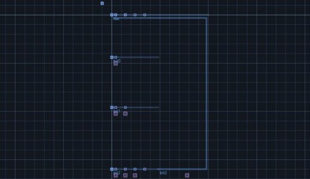](images/student-hub/l-dac.jpg) | **Lay out a capacitor DAC**. *Medium*. Compare the extracted weights of a three-bit unit-capacitor array before and after reducing routing coupling. [Guide](STUDENT_LAYOUT_LABS.md). |
| [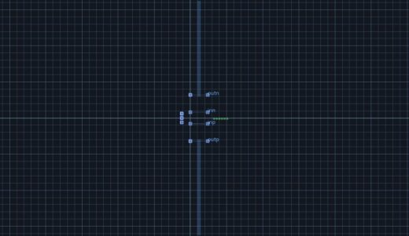](images/student-hub/l-lvs.jpg) | **Find a DRC-clean LVS failure**. *Hard*. Repair an open, a short and swapped physical ports in three copies of the differential amplifier layout. [Guide](STUDENT_LAYOUT_LABS.md). |
| [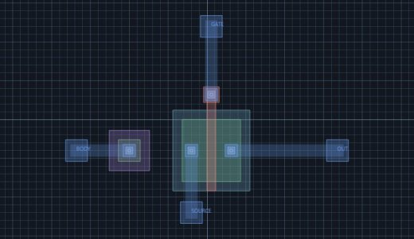](images/student-hub/l-eco.jpg) | **Change a shared cell safely**. *Hard*. Resize a GF180 transistor in one child master, regenerate its footprint and verify both placed parent instances. [Guide](STUDENT_LAYOUT_LABS.md). |
| [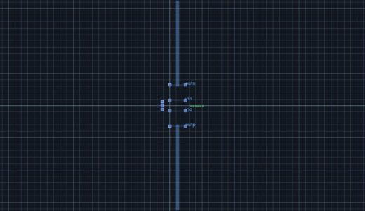](images/student-hub/l-settle.jpg) | **Recover amplifier settling time**. *Hard*. Compare transient responses from the same matched amplifier schematic and RC-estimated layout, then recover the settling margin. [Guide](STUDENT_LAYOUT_LABS.md). |
| [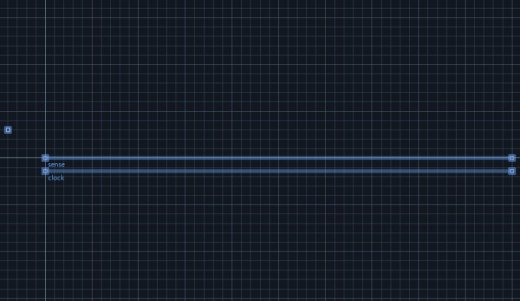](images/student-hub/l-noise.jpg) | **Quiet a noisy neighbor**. *Medium*. Compare the same clock edge across close, spaced, other-layer and grounded-shield routing configurations. [Guide](STUDENT_LAYOUT_LABS.md). |
| [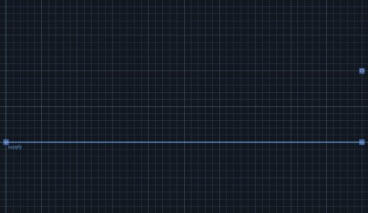](images/student-hub/l-supply.jpg) | **Repair a weak supply route**. *Hard*. Measure supply drop at a fixed load and widen a resistive route until the delivered voltage meets its requirement. [Guide](STUDENT_LAYOUT_LABS.md). |
| [](images/student-hub/l-floorplan.jpg) | **Plan a block before routing**. *Medium*. Floorplan a two-device GF180 macro and compare footprint and pin distances before routing. [Guide](STUDENT_LAYOUT_SIGNOFF.md). |
| [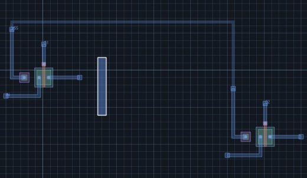](images/student-hub/l-access.jpg) | **Fix a pin-access bottleneck**. *Medium*. Route a congested internal connection without expanding the compact macro or exceeding its via budget. [Guide](STUDENT_LAYOUT_SIGNOFF.md). |
| [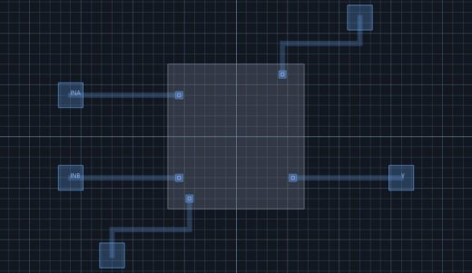](images/student-hub/l-pad-ring.jpg) | **Build a pad ring**. *Medium*. Assign perimeter supply and signal pads and trace each landing to the correct core-side terminal. [Guide](STUDENT_LAYOUT_SIGNOFF.md). |
| [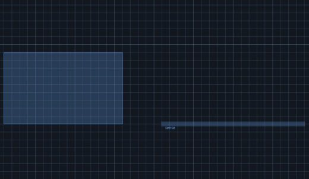](images/student-hub/l-density.jpg) | **Repair a metal-density violation**. *Medium*. Fill an underdense window and manage estimated capacitive loading on a nearby sensitive line. [Guide](STUDENT_LAYOUT_SIGNOFF.md). |
| [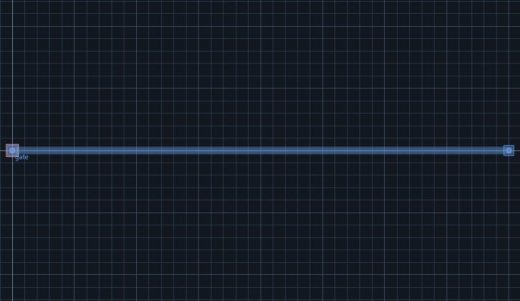](images/student-hub/l-antenna.jpg) | **Fix an antenna violation**. *Hard*. Trace a gate-connected route and compare a layer jump with a protection diode on a staged area-ratio coupon. [Guide](STUDENT_LAYOUT_SIGNOFF.md). |
| [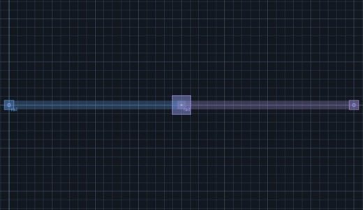](images/student-hub/l-via-current.jpg) | **Find the via current bottleneck**. *Medium*. Diagnose an overloaded transition that already meets the teaching voltage-drop target. [Guide](STUDENT_LAYOUT_SIGNOFF.md). |
| [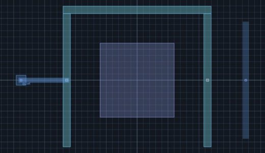](images/student-hub/l-isolation.jpg) | **Place taps and guard rings**. *Hard*. Close a guard around an analog region, place contacts and verify its separate quiet return. [Guide](STUDENT_LAYOUT_SIGNOFF.md). |
| [](images/student-hub/l-spiral.jpg) | **Tune an on-chip spiral**. *Hard*. Compare two generated coils at identical material assumptions and improve Q while preserving inductance and resonance margin. [Guide](STUDENT_LAYOUT_SIGNOFF.md). |
| [](images/student-hub/l-handoff.jpg) | **Catch a bad GDS export**. *Hard*. Export and independently reopen the routed macro, diagnose a missing pin label and verify a corrected stream. [Guide](STUDENT_LAYOUT_SIGNOFF.md). |


### Portfolio & interviews

| Screenshot | Lesson |
| --- | --- |
| [](images/student-hub/p-spec.jpg) | **01 · Write an engineering design brief**. *Easy*. Turn an open-ended circuit task into requirements, assumptions and a verification plan. |
| [](images/student-hub/p-review.jpg) | **02 · Present a reproducible design story**. *Medium*. Build a portfolio case study and practice explaining a failure, repair and remaining limitations. |


### Analog design projects

| Screenshot | Lesson |
| --- | --- |
| [](images/student-hub/project-opamp.jpg) | **Design a two-stage op amp**. *Hard*. Design a SKY130 Miller op amp for at least 40 dB gain, 100 kHz unity-gain frequency, and 45° phase margin into 1 pF. Verify bias, noise, power, startup and the extracted core. [Guide](STUDENT_ANALOG_PROJECTS.md). |
| [](images/student-hub/project-tia.jpg) | **Design a photodiode TIA**. *Hard*. Design a photodiode receiver for 100 kΩ nominal transimpedance, at least 200 kHz bandwidth, and at most 2 dB AC peaking. Verify the transistor core after extraction. [Guide](STUDENT_ANALOG_PROJECTS.md). |
| [](images/student-hub/project-miller.jpg) | **Miller compensation and the nulling resistor**. *Medium*. Derive the Miller effect, see why the capacitor stabilizes the loop, and calculate how a series resistor moves the zero. [Guide](STUDENT_MILLER.md). |
| [](images/student-hub/project-ahuja.jpg) | **Ahuja compensation for op amps**. *Hard*. Compare direct Miller and current-buffered compensation, then see how load and buffer bandwidth change the loop. [Guide](STUDENT_AHUJA.md). |
| [](images/student-hub/project-bias-reference.jpg) | **Build a current reference and bias a mirror**. *Medium*. Set a 5 µA operating point, size from measured current density, and verify the mirror at a specified load. [Guide](STUDENT_BIAS_CASCODE.md). |
| [](images/student-hub/project-cascode.jpg) | **Cascode mirrors across process and temperature**. *Medium*. Measure the cascode’s output resistance and headroom cost, then inspect current density and saturation in nine SKY130 cases. [Guide](STUDENT_BIAS_CASCODE.md). |
| [](images/student-hub/project-bandgap-widlar.jpg) | **Widlar bandgap reference**. *Hard*. Weight a PTAT voltage to cancel the falling base–emitter voltage. Trim an editable GF180 circuit, then compare measured startup before and after layout. [Guide](STUDENT_BANDGAPS.md). |
| [](images/student-hub/project-bandgap-brokaw.jpg) | **Brokaw bandgap reference**. *Hard*. Use equal collector currents and unequal emitter areas to make a PTAT term. Trim an editable GF180 circuit, then compare measured startup before and after layout. [Guide](STUDENT_BANDGAPS.md). |
| [](images/student-hub/project-bandgap-kuijk.jpg) | **Kuijk bandgap reference**. *Hard*. Use voltage feedback to enforce a diode voltage relation and set the density ratio. Trim an editable GF180 circuit, then compare measured startup before and after layout. [Guide](STUDENT_BANDGAPS.md). |
| [](images/student-hub/project-bandgap-banba.jpg) | **Banba bandgap reference**. *Hard*. Sum CTAT and PTAT currents and scale the resulting voltage below one volt. Trim an editable GF180 circuit, then compare measured startup before and after layout. [Guide](STUDENT_BANDGAPS.md). |
| [](images/student-hub/interview-differential.jpg) | **Differential pairs and common-mode range**. *Medium*. Separate current steering from common-mode headroom in a SKY130 differential pair. [Guide](STUDENT_INTERVIEW_LABS.md). |
| [](images/student-hub/interview-input-pairs.jpg) | **Choosing PMOS or NMOS input pairs**. *Medium*. Compare complementary input stages by tracing real common-mode and drain headroom, then choose a polarity for a source. [Guide](STUDENT_INTERVIEW_LABS.md). |
| [](images/student-hub/interview-gain.jpg) | **Gain, output swing, and transistor headroom**. *Medium*. Use three SKY130 drain sweeps to measure why gain collapses when the output transistor runs out of headroom. [Guide](STUDENT_INTERVIEW_LABS.md). |
| [](images/student-hub/interview-slew.jpg) | **Slew rate and precision settling**. *Hard*. Use one SKY130 follower to separate linear settling, current-limited motion, and DC tracking error. [Guide](STUDENT_INTERVIEW_LABS.md). |
| [](images/student-hub/interview-noise.jpg) | **Transistor and resistor noise budgets**. *Hard*. Measure how source resistance and device noise combine in a real amplifier over a declared bandwidth. [Guide](STUDENT_INTERVIEW_LABS.md). |
| [](images/student-hub/interview-mismatch.jpg) | **Offset, device area, and mismatch yield**. *Hard*. Separate a systematic load error from sampled threshold mismatch before choosing a yield improvement. [Guide](STUDENT_INTERVIEW_LABS.md). |
| [](images/student-hub/interview-comparator.jpg) | **Dynamic comparator delay and kickback**. *Hard*. Trace reset, current steering, and regeneration in a transistor-level clocked comparator. [Guide](STUDENT_INTERVIEW_LABS.md). |
| [](images/student-hub/interview-sar.jpg) | **Sampling, capacitor DACs, and SAR code errors**. *Hard*. Measure acquisition error and a real switch pedestal, then repair an incorrect SAR MSB capacitor. [Guide](STUDENT_INTERVIEW_LABS.md). |
| [](images/student-hub/interview-ldo.jpg) | **LDO dropout, load transients, and stability**. *Hard*. Use a SKY130 PMOS pass transistor and error amplifier to distinguish headroom limits from a ringing loop. [Guide](STUDENT_INTERVIEW_LABS.md). |
| [](images/student-hub/interview-post-layout-debug.jpg) | **Debug a post-layout settling failure**. *Hard*. Find a layout parasitic that pushes a passing schematic past its settling deadline, then repair and rerun. [Guide](STUDENT_INTERVIEW_LABS.md). |
| [](images/student-hub/project-chopper.jpg) | **Build a chopper amplifier**. *Hard*. Align input and output commutation and design the output filter for low offset, ripple and settling. [Guide](STUDENT_SIGNAL_LABS.md). |
| [](images/student-hub/project-relaxation.jpg) | **Design a relaxation oscillator**. *Medium*. Tune a Schmitt-trigger RC oscillator and verify startup, duty cycle and frequency at three rail and temperature conditions. [Guide](STUDENT_SIGNAL_LABS.md). |
| [](images/student-hub/project-pga.jpg) | **Build a programmable-gain amplifier**. *Medium*. Size a switched feedback ladder for three gain codes and verify static gain, bandwidth and switching recovery. [Guide](STUDENT_SIGNAL_LABS.md). |


### Testbenches

| Screenshot | Lesson |
| --- | --- |
| [](images/student-hub/tb-divider-bias.jpg) | **Build a divider bias bench**. *Easy*. An operating point solves the steady voltages and currents of the fixture. Put the resistor divider in its own cell and apply 1 V from the parent fixture. [Guide](STUDENT_TESTBENCHES.md). |
| [](images/student-hub/tb-divider-sweep.jpg) | **Sweep the divider input**. *Easy*. A DC sweep solves a series of operating points. Each point reuses the same fixture with a different value on the selected independent source. [Guide](STUDENT_TESTBENCHES.md). |
| [](images/student-hub/tb-divider-transient.jpg) | **Measure a loaded divider step**. *Easy*. A capacitor on the output makes the response time-dependent. The capacitor sees the two 1 kΩ resistors in parallel, so its 2 nF load gives a time constant of 1 µs. [Guide](STUDENT_TESTBENCHES.md). |
| [](images/student-hub/tb-tia-bias.jpg) | **Set the TIA bias and photocurrent**. *Medium*. The feedback resistor converts current into voltage. With the input held near a 0.9 V reference, 1 µA through 100 kΩ moves the output down by about 0.1 V for this current direction. [Guide](STUDENT_TESTBENCHES.md). |
| [](images/student-hub/tb-tia-ac.jpg) | **Measure TIA transimpedance**. *Medium*. An AC analysis linearizes around the bias point. For a 1 µA AC input, an output magnitude of 0.1 V corresponds to 100 kΩ of transimpedance. [Guide](STUDENT_TESTBENCHES.md). |
| [](images/student-hub/tb-tia-step.jpg) | **Test a photodiode current step**. *Medium*. The pulse fixture models a change in light as a current step. Observing both the settling waveform and the final output checks the feedback network under a time-domain stimulus. [Guide](STUDENT_TESTBENCHES.md). |
| [](images/student-hub/tb-opamp-bias.jpg) | **Bias a two-stage amplifier as a follower**. *Medium*. A practical amplifier bench supplies power, common-mode input, a bias current and a load. Unity feedback gives a useful operating-point check before more involved tests. [Guide](STUDENT_TESTBENCHES.md). |
| [](images/student-hub/tb-opamp-ac.jpg) | **Build the amplifier AC loop bench**. *Hard*. The large inductor keeps the feedback path closed at DC. The capacitor holds the feedback node near AC ground, letting the 1 V small-signal stimulus expose the amplifier’s gain. [Guide](STUDENT_TESTBENCHES.md). |
| [](images/student-hub/tb-opamp-step.jpg) | **Check follower step response under load**. *Medium*. The unity-gain step fixture checks whether the feedback loop can move the output with its load connected. A late output sample is a check on the final level, alongside the full waveform. [Guide](STUDENT_TESTBENCHES.md). |


### Standard Cells

Place model-linked devices, finish the supply and output routes, and compare schematic and layout-loaded results. See the [standard-cell guide](STUDENT_STANDARD_CELLS.md).

| Screenshot | Lesson |
| --- | --- |
| [](images/student-hub/sc-inv.jpg) | **Lay out and test a CMOS inverter**. *Easy*. Place the device pair, close the rail and output gaps, and compare loaded waveforms. |
| [](images/student-hub/sc-nand2.jpg) | **Lay out and test a two-input NAND**. *Medium*. Trace the NMOS stack and test all four vectors after routing. |
| [](images/student-hub/sc-nor2.jpg) | **Lay out and test a two-input NOR**. *Medium*. Trace P_STACK and test the four loaded pull-up and pull-down cases. |
| [](images/student-hub/sc-aoi21.jpg) | **Lay out and test an AND-OR-invert cell**. *Medium*. Finish the rail and output routes, then verify all eight vectors. |
| [](images/student-hub/sc-mux2.jpg) | **Lay out and test a transmission-gate multiplexer**. *Medium*. Inspect S and S_B routing and measure both input paths. |
| [](images/student-hub/sc-dff.jpg) | **Lay out and test a rising-edge D flip-flop**. *Hard*. Close the Q path and compare capture and hold in both models. |

#### Design challenges

| Screenshot | Lesson |
| --- | --- |
| [](images/student-hub/sc-inv-compact.jpg) | **Fit an inverter into a 12.8 µm cell**. *Easy*. Reduce horizontal pitch while keeping the rail alignment and logic function. |
| [](images/student-hub/sc-nand-drive.jpg) | **Drive 40 fF with a faster NAND**. *Medium*. Size the stack to meet a 100 ps falling-delay target. |
| [](images/student-hub/sc-dff-clock.jpg) | **Meet the flip-flop clock-to-Q budget**. *Hard*. Tune both clock-to-Q edges while respecting the combined driver width cap. |

### CMOS inverter · PDK to LVS

| Screenshot | Lesson |
| --- | --- |
| [](images/student-hub/inverter-process.jpg) | **Choose a process and read its limits**. *Easy*. A process design kit connects a circuit to a manufacturing process. [Guide](STUDENT_INVERTER.md). |
| [](images/student-hub/inverter-schematic.jpg) | **Build the CMOS inverter and its testbench**. *Easy*. An inverter is a complementary pull-up and pull-down network. [Guide](STUDENT_INVERTER.md). |
| [](images/student-hub/inverter-dc.jpg) | **Measure the DC transfer curve**. *Medium*. The voltage transfer characteristic relates a static input to the settled output. [Guide](STUDENT_INVERTER.md). |
| [](images/student-hub/inverter-transient.jpg) | **Measure switching and propagation delay**. *Medium*. tPHL is the delay from a rising input crossing 50% VDD to a falling output crossing 50%; tPLH uses the opposite edges. [Guide](STUDENT_INVERTER.md). |
| [](images/student-hub/inverter-layout.jpg) | **Turn the schematic into process geometry**. *Medium*. Start with the well and active regions, then identify gate crossings, source/drain implants, contacts and metal routes. [Guide](STUDENT_INVERTER.md). |
| [](images/student-hub/inverter-drc.jpg) | **Find and repair a real DRC violation**. *Hard*. A design rule check compares mask geometry with process constraints: minimum width, spacing, enclosure, overlap, allowed grids and more. [Guide](STUDENT_INVERTER.md). |
| [](images/student-hub/inverter-lvs.jpg) | **Extract and compare the circuit with LVS**. *Hard*. LVS starts with extraction: the tool recognizes transistors and connections from physical layers. [Guide](STUDENT_INVERTER.md). |
| [](images/student-hub/inverter-handoff.jpg) | **Review the inverter as a design deliverable**. *Hard*. A design review connects requirements to evidence. [Guide](STUDENT_INVERTER.md). |


### Advanced project

| Screenshot | Lesson |
| --- | --- |
| [](images/student-hub/c-filter.jpg) | **01 · Size the sensor input filter**. *Medium*. Repair the acquisition bandwidth in the shared sensor-acquisition project. |
| [](images/student-hub/c-sar.jpg) | **02 · Integrate repeated SAR conversion**. *Hard*. Repair decision polarity and verify eight conversion transactions. |
| [](images/student-hub/c-average.jpg) | **03 · Add averaging and threshold detection**. *Medium*. Repair fixed-point scaling and verify data-valid and alarm timing. |
| [](images/student-hub/c-qualify.jpg) | **04 · Qualify and present the system**. *Hard*. Run the complete acceptance campaign and deliver a reproducible engineering record. |
| [](images/student-hub/c-temperature.jpg) | **Build a calibrated temperature monitor**. *Hard*. Set sensor span, convert against a shared reference, program two-point integer calibration and validate held-out temperatures and supplies. [Guide](STUDENT_SIGNAL_LABS.md). |


The inverter illustrations use SKY130A. Choose a supported revision in Studio to repeat the same eight stages with that process's models and rules. The four sensor-acquisition milestones share an editable project. The calibrated temperature monitor is a separate project in the same world.

## Learn beside the real editor

1. **Find a lesson.** Select a world in **Map**, choose **List**, or use **Search all lessons**. The status filter shows which lessons are ready or complete. **Continue learning** resumes eligible unfinished work.
2. **Pick your learning mode.** **Do It Yourself** gives you the design goal. **Step by Step** gives you the edits and measurements in order. The Hub remembers your choice per lesson.
3. **Open the project.** **Start lesson** creates a saved workspace. **Resume lesson** reopens your edits. The Lesson Guide stays beside the schematic, layout, or RTL editor.
4. **Run and check your work.** Use **Run lesson** and **Results** for measured tasks. **Check this step** evaluates your edits and the saved evidence. **Next step** advances the guide.
5. **Record what you found.** Reflection drafts save as you type. **Record reflection** adds the note to your learning record. **Save work** keeps the design edits.

<details><summary>List view and Lesson Guide</summary>


</details>

Use **All difficulties** to filter lessons by level. Use **Ctrl+F** on Windows and Linux or **Cmd+F** on macOS to search. Tab into the map, use arrow keys to move between worlds, and press Return or Space to open a world. Press Esc in the search field to return to your previous selection. **Student Hub menu → Text size** scales the Hub and the Lesson Guide up to 200%.

### Help and solutions

- **Quick check** lets you try a prediction from the lesson preview. **Hints** includes four common student questions for each knowledge check. Select one to reveal its advice.
- **Show step images** opens the visual walkthrough for the current guided checkpoint. Switch images to see the schematic, an edit close-up, matching controls, or a saved result when one is available. Use **Fit to window**, **Actual size**, or **200%**.
- **Show solution** opens a worked solution in either learning mode. Use its checkpoint selector to switch between example edits, expected measurements, answers, and a reflection example.
- **Ask Resisty** opens the AI helper with a suggested question. Connect a provider through **Set Up**, review the context with **Full request**, then use **Send**.

<details><summary>Hints, step images, a worked solution, and Resisty</summary>


</details>

### Two native testbench workflows

The nine [Testbenches lessons](STUDENT_TESTBENCHES.md) teach operating points, DC sweeps, AC gain, and transient response. Choose **Graphical testbench** to configure the fixture, probes, and measurements in Studio's saved-testbench editor. Choose **SPICE program** to write the native ngspice analysis and measurement commands. Both use the same editable circuit and pass criteria. **Results** lets you compare the saved measurement, waveform, and log from either workflow.

<details><summary>Graphical testbench, SPICE program, and saved results</summary>


</details>

Use **View → Lesson guide** to reopen the guide while working. **Cancel lesson runs** stops runs from that lesson project. Use **Student Hub menu → Locate lesson project** if you move a saved file, or **Reload progress** to read edits saved by another window. See the [Student Hub workflow audit](STUDENT_HUB_AUDIT.md) for the desktop checks.


## gm/ID: from requirement to verified bias

Analog 7–10 teach `gm = ∂ID/∂VGS`, efficiency in V⁻¹, current density,
width estimation and voltage headroom. Each starter has a bias or sizing problem;
the numerical checkpoint reads the captured operating point and rejects stale
results. **Results** opens the saved analog run inspector with device values.

For the included generic NMOS at L=1 µm, VGS=.65 V and VDS=1 V, a 10 µm
reference width gives ID=20.4 µA and gm/ID≈10 V⁻¹. A 200 µS gm target therefore
requires ID=20 µA and W≈9.804 µm. The final exercise reaches approximately the
same gm at half the current and twice the width, then asks what capacitance,
noise and process evidence is missing. These are teaching-model operating-point
results; a hand estimate of bandwidth is not a measured amplifier specification.

For process-model work, continue through **Analysis → Analog design workspace →
Optimize → gm/Id explorer → Device characterization library**. Characterize the
chosen length, drain/body bias, temperature and corner; size within measured
data, rerun the proposed device and verify circuit performance. See the
[analog optimizer](ANALOG_OPTIMIZER.md). The methodology reference is
[Jespers and Murmann's book and companion material](https://github.com/bmurmann/Book-on-gm-ID-design).


## Layout: repair, measure and explain

Use the rectangle inspector's **Geometry (µm)** fields; stored coordinates use
integer nanometres. The four exercises require 0.20 µm route thickness,
0.20 µm edge spacing, at least 0.075 µm via enclosure on both metals, and equal
centroids for four separated, equal-size tiles. The checker preserves the
original shapes/layers/nets and applies a fixed generic deck, so deleting an
offending shape or relaxing editable PDK rules does not pass.

The matching exercise uses labeled metal tiles to teach placement arithmetic.
It does not extract resistor or transistor devices. Each review distinguishes
geometric DRC, extracted connectivity, LVS and parasitic verification. Actual
process rules depend on the selected PDK; consult, for example, the
[SKY130 process design rules](https://skywater-pdk.readthedocs.io/en/main/rules.html)
and the application's [PDK guide](PDK_GUIDE.md).

## Digital: learn from failing implementations

The three additional RTL starters intentionally omit a combinational assignment,
wrap an accumulator that should saturate, or misalign validity with pipeline
data. Run the broken starter, repair the RTL, then rerun the unchanged reference
bench. The benches check input histories, arithmetic boundaries, invalid-cycle
hold, bubbles and reset as appropriate to each interface. Passing compilation
alone does not earn the simulation checkpoint.

The pipeline lesson explains edge timing, latency versus throughput, setup/hold
verification and why clock-domain crossings need a separate design. Its interface
has no backpressure. Synthesis and static timing remain follow-up work in the
[digital flow](DIGITAL_FLOW.md); the conceptual reference is
[Yosys's explanation of synthesis and sequential logic](https://yosyshq.readthedocs.io/projects/yosys/en/0.39/CHAPTER_Basics.html).

## Prepare a portfolio and a design conversation

The portfolio path guides students through a requirement with units and operating
conditions, assumptions, an alternative design, a test matrix and a 90-second
project explanation. Every lesson supplies a related interview prompt and an
artifact to keep. The two portfolio milestones share a saved current-mirror
case study, while the final review can cite any completed design lesson.

**Student Hub menu → Export portfolio report** writes standalone HTML that opens in a browser
and can be printed. It includes lesson status, portfolio outcomes, student drafts
and captured evidence. **Export learning record** still provides the JSON project
snapshots. Both save the active lesson first and respect Save cancellation.
Review drafts and local file paths before sharing. The HTML references evidence;
it does not embed raw simulation files. Neither export certifies engineering
correctness of reflections or guarantees employment.

## Engines and models

Foundations and the introductory Analog labs use the included teaching solver and generic devices.
The Testbenches world, process-specific analog labs, and measured signal experiments use ngspice. For the native graphical and text exercises, see the [testbench guide](STUDENT_TESTBENCHES.md).
Digital lessons use Icarus and embedded reference testbenches through the
selected **Included tools** or **Custom tools** digital toolchain. **Run lesson**
opens digital setup when Included tools are not ready and resumes after
successful setup. **Student Hub menu → Engine setup… → Digital tools setup…** opens the same
setup panel. In Custom mode, the Hub's Icarus fields override the shared custom
paths when provided; in Included mode they do not override the managed runtime.

Mixed Signal and the capstone run the native ngspice/Icarus closed loop described
in the [SAR walkthrough](MIXED_SIGNAL_SAR.md). **Student Hub menu → Engine setup…** selects
those native `ngspice`, `iverilog` and `vvp` executables. **Check native mixed-signal engines**
reports all missing prerequisites together. Blank Icarus fields search PATH;
blank ngspice uses Studio's native discovery, including its bundled executable
and `ICSTUDIO_NGSPICE`. Earlier mixed-signal selections are used as defaults.
Paths copied with surrounding quotes are accepted.

On Ubuntu, `sudo apt install ngspice iverilog` supplies the native tools. On
Windows, select native Windows executables; the source launcher provisions
ngspice only, and Icarus needs a separate native installation. The setup panel
links to the [native installation guide](MIXED_SIGNAL_SAR.md#local-engine-setup)
and does not download native Icarus. WSL executable paths and a Ready managed
digital runtime do not satisfy Mixed Signal or capstone prerequisites. Tool
availability and successful process startup alone are not numerical qualification.

The generic analog lessons introduce concepts with simplified devices. The transistor-level analog projects use bundled process models, and process-specific physical verification uses the matching locked decks.
Generic MOS results exclude body effect, subthreshold behavior and device
capacitances. The SAR comparator and switch are behavioral. The course does not
establish foundry DRC/LVS, transistor-level ADC accuracy, ENOB/SNDR or silicon
performance. Later physical work needs a selected, qualified process and its
actual decks and models.

## Advanced project: sensor acquisition system

The signal chain is an RC input filter, sample/hold, four-bit SAR, four-sample
block averager, and threshold alarm. The starter intentionally contains three
faults: an excessive filter capacitor, inverted SAR comparator interpretation,
and an incorrect averaging shift. Each milestone repairs one block and measures
its own requirements before the final system campaign.


| Requirement | Target |
| --- | --- |
| Reference / clock | 1.8 V / 1 µs |
| Input filter | 1 kΩ and 100 pF; 100 ns time constant |
| Nominal input sequence | 0.2, 0.4, 0.6, 0.8, 1.0, 1.2, 1.4, 1.6 V |
| Raw codes | 1, 3, 5, 7, 8, 10, 12, 14 |
| Completion edges | 7, 15, 23, 31, 39, 47, 55, 63 |
| Acquisition error | Less than 2 mV at the first comparison of each conversion |
| Averaging | Non-overlapping blocks of four; `(sum + 2) >> 2`, halves rounded upward |
| Averaged codes | 4 and 11 |
| Average-valid edges | 32 and 64; SAR completion is consumed on the next clock |
| Alarm | Assert when the averaged code is at least 10; nominal outputs 0 then 1 |

**Run qualification** captures four copies of the reviewed design: nominal,
below-range input, above-range input, and input changes after acquisition.
The open project is unchanged. All code, cadence, averaging, alarm, sample-count,
decision-count and acquisition requirements must pass for all four cases.
The checker uses fixed independent reference requirements; it does not infer
expected codes from the edited DAC or RTL.

The original correct reference design can be generated and independently tested
with `python scripts/verify_student_capstone.py --out build/student-capstone`.
It is separate from the intentionally faulty teaching starter. The script also
injects filter, comparator-decision, averaging and alarm faults to demonstrate
that the acceptance requirements detect them.

## Progress and evidence

Progress is stored in the application's local data directory under `student-hub`.
Project files remain normal `.icproj` documents. **Save As** followed by **Save
work** updates the lesson's resume location. If a lesson file goes missing or is
replaced by another project, the Hub reports the problem instead of resetting it.
Corrupt or concurrently changed progress is not silently overwritten.

An earned checkpoint includes its project identity/design hash and, for a run,
the captured job/result hashes, engine/environment identity and run location.
Digital and mixed-signal artifacts are revalidated using the existing job reader.
Results from earlier edits, another project, interrupted jobs or a changed
reference testbench cannot earn a numerical checkpoint. Even Undo produces a
new project revision; rerun before earning a new simulation checkpoint.

Earned steps are historical achievements, not claims about all future edits.
Updating a checkpoint lesson or its grading revision requires rechecking that lesson;
unrelated application releases preserve progression. Dependent progression also
checks its prerequisites. Teaching notes are stored separately in `study-guide.json`,
so improving an explanation does not invalidate existing checkpoint credit.
**Export learning record** writes JSON
with progress, reflections, saved project snapshots and evidence references. Save
edits before exporting. Raw run directories are referenced, not embedded; include
them separately when sharing a complete reproducible simulation package.

## Feature map and further work

| Feature | Guided entry | Further workflow |
| --- | --- | --- |
| Schematic, properties, nets and ground | Foundations 1–3 | [Getting started](GETTING_STARTED.md) |
| Hierarchy, cells and reusable blocks | Foundations 4 | [Getting started](GETTING_STARTED.md) |
| Analysis, traces and comparison | Foundations 1–5; Analog 1–5 | [Analog workspace](ANALOG_WORKSPACE.md) |
| Bias, gm/ID, specifications and closure | Analog 3–5 and 7–10 | [Analog closure](ANALOG_CLOSURE.md) |
| Optimization and variation studies | Analog 5 reflection | [Analog optimizer](ANALOG_OPTIMIZER.md) |
| Layout, matching and physical evidence | Foundations 6; Analog 6; Layout 1–4 | [Layout scale and collaboration](LAYOUT_SCALE_AND_COLLABORATION.md), [PDK guide](PDK_GUIDE.md) |
| RTL, testbenches and digital waveforms | Digital 1–9 | [Digital workspace](DIGITAL_WORKSPACE.md) |
| Synthesis, timing and implementation | Digital 6 extensions | [Digital flow](DIGITAL_FLOW.md) |
| Bridge timing, DACs and SAR conversion | Mixed Signal 1–6 | [Mixed-signal SAR](MIXED_SIGNAL_SAR.md) |
| Captured runs, cancellation and handoff | Every measured lesson; capstone 4 | [Project Hub](PROJECT_HUB.md) |

These links expose the broader application without treating unperformed
optimization, physical verification or implementation as completed course work.

## Developer verification

```sh
python -m unittest discover -s tests -p 'test_student*.py' -v
python scripts/verify_student_capstone.py --out build/student-capstone
QT_QPA_PLATFORM=offscreen python tests/gui_student_hub.py
QT_QPA_PLATFORM=offscreen python tests/gui_student_design_labs.py
```

Run from the repository root in its Python environment, with a fresh output
directory for each captured campaign. In PowerShell, set
`$env:QT_QPA_PLATFORM = 'offscreen'` before the GUI command instead of using the
POSIX assignment prefix. The capstone script also accepts `--ngspice`,
`--iverilog` and `--vvp` paths for an explicitly selected native toolchain.

The unit suite exercises the curriculum starters, prerequisite cycles, persistence,
concurrent writes, stale/corrupt evidence, the foundational circuits,
nine real RTL reference benches, layout repair and bypass rejection, escaped HTML
portfolio exports, six mixed-signal lessons and capstone fault
detection. Engine tests require installed tools or `ICSTUDIO_TEST_NGSPICE`,
`ICSTUDIO_TEST_IVERILOG` and `ICSTUDIO_TEST_VVP`. The desktop check additionally
tests save cancellation, practice without credit, shared capstone work, export,
autosaved notes and cancellation. CI uploads raw evidence directories.

## Retained execution evidence

The [design-path expansion checks](validation/student-design-paths/checks.json)
record 1,225 unit tests (54 optional skips), 16 focused tests with native Icarus
and ngspice (no skips), and three Windows offscreen GUI workflows. The new
layout repairs were performed through the real inspector; this remains generic
geometry evidence rather than foundry or packaged-desktop qualification.

The following records describe the earlier 28-lesson course on Linux.

The [capstone campaign](validation/student-hub/capstone.json) passed all four
acceptance cases and detected all four deliberately injected faults. The
[desktop record](validation/student-hub/desktop.json) records the exercised
learning workflow. [Test commands and outcomes](validation/student-hub/checks.json)
include the full suite (1,216 tests, 51 skipped), 10 focused progression/engine
tests, and the six final progression regressions, including update-stable credit
and packaged-build identity handling. The [release consistency check](validation/student-hub/release-check.json)
also passed.

Numerical and desktop evidence was executed on Linux with Qt offscreen,
Python 3.12, ngspice 42 and Icarus 12. The existing
[host runtime record](validation/mixed-signal-sar/host-runtime.json) identifies the
same underlying binaries and workspace-specific scratch-file adapter. The frozen
identity check emulates the packaged source layout; this record does not claim a
complete packaged or native Windows run. Raw captures are retained by the CI
workflow; compact reports and screenshots are committed here.
