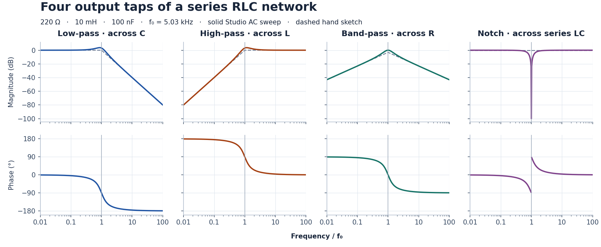

# LC filters and Bode plots

In **Student Hub → Analog**, open **LC filters and Bode plots**. Draw your
prediction before opening **Results**. The editable bench uses a 1 V AC source
and four unloaded output taps with the same series values, 220 Ω, 10 mH and
100 nF. The resistor includes the series damping in the classroom model.

## Derive the transfer functions

Use `ZL = sL` and `ZC = 1/(sC)`. Divide the impedance across the chosen output
by `R + ZL + ZC`, then multiply the numerator and denominator by `sC`.
Let `ω₀ = 1/√(LC)`, `Q = √(L/C)/R` and `x = s/ω₀`. All four taps share the
denominator `D = 1 + x/Q + x²`. The poles are the roots of that denominator.
The location of the output tap changes the numerator and therefore the zeros.

| Output tap | H(s) | Zeros | Slope below → above the break |
| --- | --- | --- | --- |
| C, low-pass | `1/D` | None at finite frequency | 0 → −40 dB/dec |
| L, high-pass | `x²/D` | Two at the origin | +40 → 0 dB/dec |
| R, band-pass | `(x/Q)/D` | One at the origin | +20 → −20 dB/dec |
| Series LC, notch | `(1 + x²)/D` | `s = ±jω₀` | 0 → 0 dB/dec, with a null at f₀ |

A first-order pole contributes −20 dB/decade above its break and tends
toward −90° phase. A left-half-plane zero contributes +20 dB/decade and
positive phase. A right-half-plane zero has the same magnitude slope and
negative phase. Origin factors already contribute over the whole plotted
range. The two-pole asymptote says how fast the curve ultimately rolls
off. Damping and pole locations determine the shape of the transition.
[MIT OpenCourseWare on Bode asymptotes](https://ocw.mit.edu/courses/2-004-dynamics-and-control-ii-spring-2008/44d3d6d64792041e12a1c2fcf0d54fc2_lecture_34.pdf)

## Plot one by hand

1. Compute `f₀ = ω₀/(2π) ≈ 5.033 kHz` and `Q ≈ 1.437`. Put
   `0.01f₀`, `0.1f₀`, `f₀`, `10f₀`, and `100f₀` at equal horizontal
   spacings. Mark a vertical axis in dB and a second plot in degrees.
2. Use the straight-line slopes to place the points in the table. Draw a
   notch dip at `f₀`. For the band-pass, the two tails meet at
   `−20 log₁₀ Q ≈ −3.15 dB` on the straight-line sketch.
3. To get exact points, substitute `x = j f/f₀`, compute the complex
   quotient, and plot `20 log₁₀|H|` and `arg H`. At `f₀`, the
   low-pass is `−jQ`, high-pass is `+jQ`, and band-pass is `1`.
   That gives +3.15 dB at −90° for the low-pass, +3.15 dB at +90° for
   the high-pass, and 0 dB at 0° for the band-pass. At the notch zero,
   magnitude is zero and phase is undefined.
4. Run **Run AC sweep → Results**. Choose each output and compare your
   sketch with the measured curve. The magnitude plot floors the very deep
   null at −100 dB. Its depth in real hardware depends on balance and loss.

| Straight-line magnitude | 0.01 f₀ | 0.1 f₀ | f₀ | 10 f₀ | 100 f₀ |
| --- | ---: | ---: | ---: | ---: | ---: |
| Low-pass | 0 | 0 | 0 | −40 | −80 |
| High-pass | −80 | −40 | 0 | 0 | 0 |
| Band-pass | −43.15 | −23.15 | −3.15 | −23.15 | −43.15 |
| Notch | 0 | 0 | null | 0 | 0 |

Use the same horizontal scale for phase. Put the low-pass near 0° at the
left, −90° at f₀ and −180° at the right. The high-pass moves from about
+180° through +90° to 0°. The band-pass moves from about +90° through
0° to −90°. For the notch, draw two phase segments. The phase approaches
−90° just below the null and +90° just above it in this model. Leave a gap
at the zero itself.

For a worked point away from resonance, use the low-pass at `f = 2f₀`.
The denominator is `−3 + j(2/Q) ≈ −3 + j1.39`. Its length is about 3.31
and its angle is about +155°. Taking the reciprocal gives a gain of 0.302,
or −10.4 dB, and a phase of about −155°. Plot those values at the same
horizontal position and compare them with the simulator’s cursors.

## Make a design change

Raise `RLP` to 470 Ω. The new Q is about 0.673, the natural frequency stays
near 5.03 kHz, and the low-pass magnitude at `f₀` becomes about −3.44 dB.
The −3 dB low-pass cutoff coincides with `f₀` for the special case
`Q = 1/√2`. Mark both frequencies on your sketch.

Next, set `CLP` to roughly 25.33 nF to put the natural frequency at 10 kHz
with the same 10 mH inductor. Leaving the resistor unchanged also changes Q.
Recalculate R to hold Q fixed, then compare the plotted shapes. An external
load, source impedance, and inductor ESR change the actual divider and damping.
