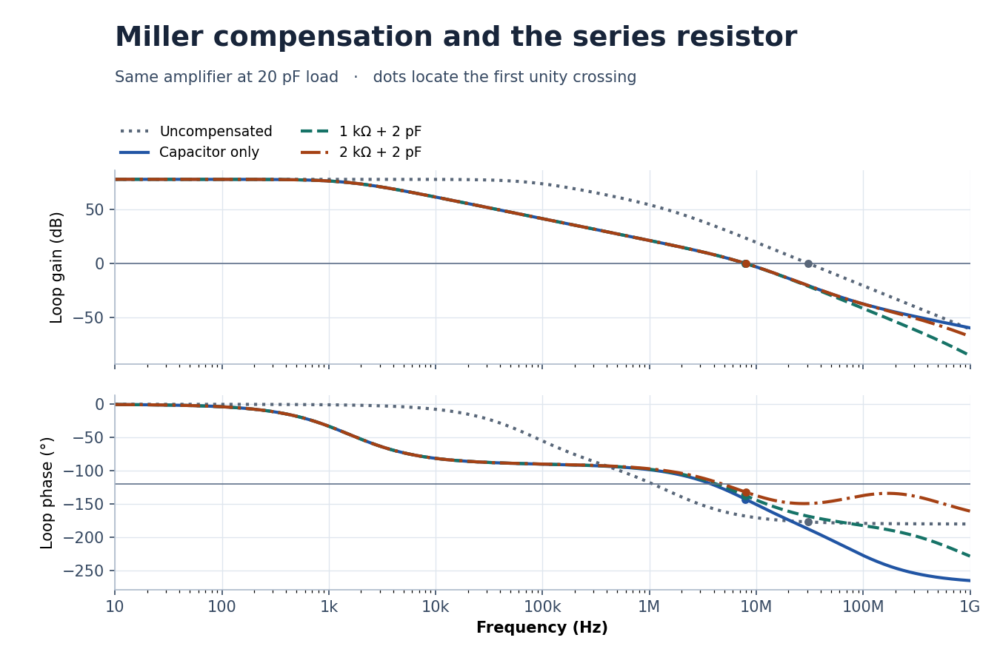

# Miller compensation and the nulling resistor

Open **Student Hub → Analog design projects → Miller compensation and the
nulling resistor**. Use **Open workspace** to trace the compensation
capacitors from the first gain stage to the output in the editable SKY130
reference. Use **Open loop comparison** to vary the compensation capacitor,
the series resistor, and the output load in a two-node small-signal model.

## A small capacitor can look much larger

The compensation capacitor spans the inverting stage. If the first-stage
node rises while the output falls, the voltage across the capacitor changes
more than the voltage at the first-stage node alone.

1. The current drawn at the first node is `i_c = Cc × d(v₁ − vo)/dt`.
2. At low frequency, approximate `vo = Av × v₁` with constant inverting gain `Av`.
3. Substitution gives `i_c = Cc(1 − Av) × dv₁/dt`. The first node sees an
   equivalent capacitance `Cin ≈ Cc(1 − Av)` from this branch.

For `Cc = 2 pF` and `Av = −100`, the effective input capacitance is
`2 pF × 101 = 202 pF`. With `R₁ = 500 kΩ` and `C₁ = 0.2 pF`, the
single-node estimate `1/[2πR₁(C₁ + Cin)]` is about **1.57 kHz**. The
two-node model puts the poles near **1.54 kHz** and **7.4 MHz** with the
capacitor at a 20 pF load. Without compensation they are about
**79.6 kHz** and **1.59 MHz**. This separation is called pole splitting.
A lower dominant pole lets loop gain start falling before the other pole
adds substantial phase lag. A larger compensation capacitor also reduces
bandwidth in this example.

The effective-capacitance calculation uses the low-frequency stage gain.
Read actual crossover and phase margin from the full loop. With a series
resistor the approximation applies at frequencies well below
`1/(2πRzCc)` as well.

## Derive the zero from the series branch

Connect `Rz` **in series** with `Cc` between `v₁` and `vo`. The two
components carry the same branch current. The capacitor blocks DC,
so the branch shapes frequency response while preserving the DC gain
in this model. Start with impedance and invert it to get the admittance.

```text
Zc = Rz + 1/(s Cc)
Yc = 1/Zc = s Cc / (1 + s Rz Cc)
```

Let `Y₁ = 1/R₁ + sC₁`, `Y₂ = 1/R₂ + sCL`, and let the
inverting output stage draw `gm₂·v₁`. Write one current balance per node.

```text
(Y₁ + Yc) v₁ − Yc vo           = gm₁ vi
(gm₂ − Yc) v₁ + (Y₂ + Yc) vo  = 0
```

Solving for `T = −vo/vi` gives the positive low-frequency return ratio
for this unity negative feedback example.

```text
T = gm₁ (gm₂ − Yc) / [Y₁Y₂ + Yc(Y₁ + Y₂ + gm₂)]

Clear the branch fraction in the numerator
gm₂(1 + s Rz Cc) − s Cc = gm₂[1 + s Cc(Rz − 1/gm₂)]

Therefore the zero is at
s_z = 1 / [Cc(1/gm₂ − Rz)]
```

The sign of `s_z` gives the half plane. Divide its magnitude by `2π` to
report a frequency in hertz. A right-half-plane zero adds phase lag. A
left-half-plane zero adds phase lead. Both turn the magnitude slope upward,
so read the phase as well as the gain.
[Original two-stage analysis and the series resistor](https://milindsweb.amved.com/docs/Ahuja_Compensation_Paper.pdf)

## Work the example, then change one value

Keep `gm₂ = 1 mS`, `Cc = 2 pF` and `CL = 20 pF`. The resistor at
which the finite zero disappears is `Rz = 1/gm₂ = 1 kΩ`.

| Series Rz | Compensation zero | First unity gain | Phase margin |
| --- | --- | ---: | ---: |
| No compensation branch | No compensation zero | 30.80 MHz | 3.1° |
| 0 Ω | RHP, 79.6 MHz magnitude | 7.93 MHz | 37.4° |
| 500 Ω | RHP, 159.2 MHz magnitude | 7.92 MHz | 40.1° |
| 1 kΩ | At infinity | 7.92 MHz | 42.8° |
| 2 kΩ | LHP, 79.6 MHz magnitude | 7.96 MHz | 48.0° |



Read phase margin as `180° + ∠T` at each curve’s first falling 0 dB
crossing. Nulling the zero leaves the example below the 60° exercise
target. Try 4 pF with 2 kΩ at the same load. The small-signal model
gives about 64° with a slower crossover. Change the load again and
explain the tradeoff. In a transistor design, check the loop over load
and bias conditions because `gm₂`, the parasitic poles, and the
measured margin vary.
