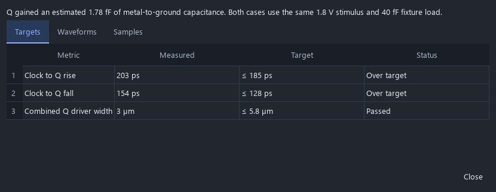
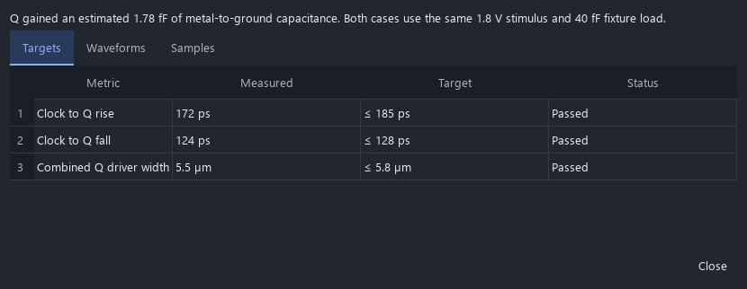
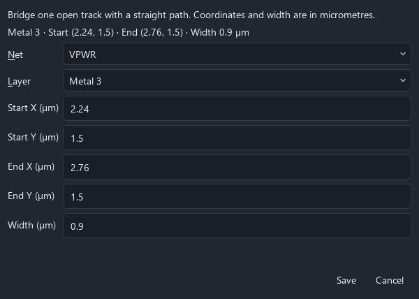
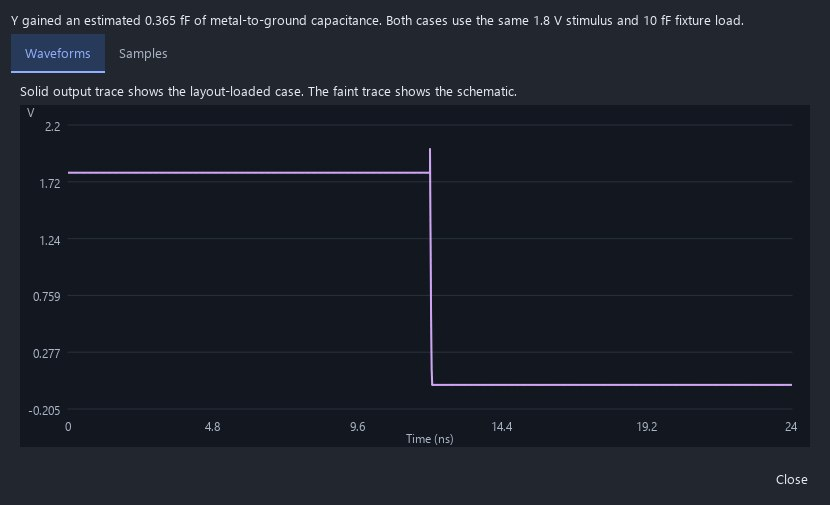
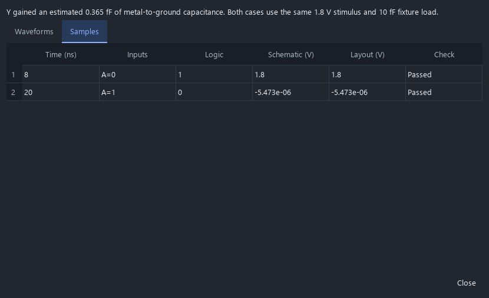

# Standard Cells

Open **Student Hub → Standard Cells** in IC Design Studio. Each lesson starts
with a working transistor schematic and an empty physical view. Place the
devices, finish two Metal 3 connections, check the layout, and test the
result against the schematic.

## Design challenges

| Difficulty | Challenge | Targets |
| --- | --- | --- |
| Easy | Fit an inverter into a 12.8 µm cell | Width ≤ 12.8 µm and both logic levels correct with 10 fF |
| Medium | Drive 40 fF with a faster NAND | B rising to Y falling ≤ 100 ps with A held high, plus all four truth-table vectors |
| Hard | Meet the flip-flop clock-to-Q budget | Q rise ≤ 185 ps and Q fall ≤ 128 ps with 40 fF, combined Q driver width ≤ 5.8 µm, and capture and hold pass |

Open **Size and place** to choose your starting dimensions. Adjust the
inverter pitch, the width of each series NMOS in the NAND, or the separate
NMOS and PMOS widths of the flip-flop's Q driver. Route the gaps and run
the lesson. **Results → Targets** shows each measured value beside its limit.
Use **Revise design** to try another size. Rebuilding opens the two routing
gaps again, and **Undo** restores the earlier layout.

The inverter starter measures 13.8 µm wide. The loaded NAND starter
measures 138.5 ps. The loaded flip-flop starts at 203.0 ps rising and
153.7 ps falling. Each starter passes its logic samples, so the Targets tab
shows exactly which design limits still need work.

## Layout lessons

| Cell | What to trace in layout | What to test |
| --- | --- | --- |
| INV | A reaches both gates and Y joins both drains | Both input levels |
| NAND2 | N_STACK joins the two series NMOS devices | All four vectors, including the 11 pull-down |
| NOR2 | P_STACK joins the two series PMOS devices | All four vectors, including the 00 pull-up |
| AOI21 | C reaches the direct pull-down and its complementary pull-up device | All eight vectors, including C overriding A and B |
| MUX2 | Separate S and S_B routing controls both transmission gates | All eight select and data combinations |
| DFF | CLK and CLK_B reach the latch switches. Q reaches the output pin and slave feedback. | Rising-edge capture and hold between edges |

## Place and route

1. Choose **Place cell rows**. Studio places the model-linked SKY130 devices,
   terminal contacts, via stacks, and an unfinished set of metal tracks. Look
   for the PMOS row above the NMOS row. All nine exercises use a 24.5 µm
   teaching row, with the upper VPWR and lower VGND centers at Y = 1.5 µm and 23 µm.
   Both rails reach the side boundaries so adjacent cells can share the rail heights.
2. Inspect the footprint and physical pins. Signal ports reach the left edge
   on Metal 3. Follow the Metal 2 drops and vias to the terminals. Internal
   tracks such as N_STACK and CLK_B stop inside the boundary.
3. In **Complete and check the layout**, find the two gaps. Use **Add route**
   to enter a Metal 3 path's endpoints and width. In **Step by Step**, the
   route form shows the measurements for the selected track. Bridge VPWR
   at 0.9 µm width and the Y or Q signal at 0.64 µm.
4. Choose **Check this step** to confirm physical pin connectivity and the
   exercise widths and spacing. An open or short blocks the layout test.

## Test the routed cell

Choose **Run lesson** for two native ngspice transients using the same 1.8 V
stimulus and fixture load. The layout lessons use a 10 fF load and the
timing challenges use 40 fF. The layout-loaded case adds a lumped
metal-to-ground capacitance estimate from the current connected polygons.
The **Results** window shows the added output capacitance, overlaid voltages,
and a **Samples** table with the expected logic and both measured voltages.
Rerun the pair after editing the layout so the checkpoint can use the current design.

The combinational fixture applies binary-count vectors in the listed pin order.
The grader reads the output 8 ns into each 12 ns slot. Logic low is at most
0.36 V and logic high is at least 1.44 V. The flip-flop uses separate data and
clock sources.

The timing challenges measure from the input crossing to the matching
output crossing at 0.9 V, half the supply. The DFF challenge adds an
extra clock edge to measure a rising Q after a known low state.

| Time | D | CLK | Expected Q | What the sample shows |
| --- | --- | --- | --- | --- |
| 30 ns | 1 | 1 | 1 | First rising edge captured a 1 |
| 42 ns | 0 | 1 | 1 | Q held after D fell |
| 56 ns | 0 | 0 | 1 | Falling clock edge kept Q |
| 79 ns | 0 | 1 | 0 | Second rising edge captured a 0 |
| 99 ns | 1 | 0 | 0 | Q held after D rose again |

**Show step images** shows the active layout and route form. **Do It Yourself**
gives the layout and test targets. **Show solution** explains both missing
routes and the expected test samples. The new layout lessons use their own
workspace, so earlier schematic projects are still saved.

The capacitance model uses declared teaching coefficients for area and perimeter.
The same bundled SKY130A transistor models drive both runs. The [CMOS inverter
course](STUDENT_INVERTER.md) covers process-deck DRC, LVS, and handoff.
