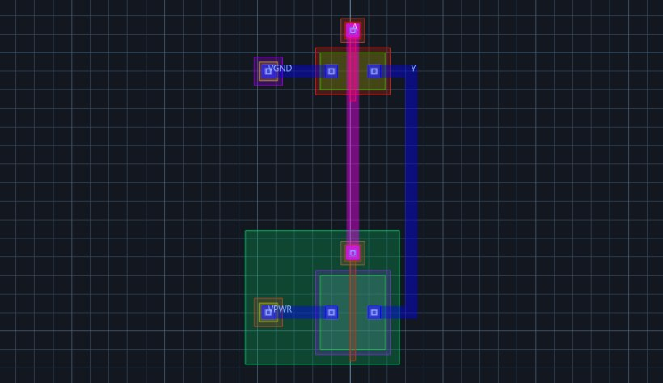

# Standard Cells

Open **Student Hub → Standard Cells** in IC Design Studio. Begin with the
inverter. It introduces the reusable cell and its separate test fixture.
The other lessons reuse that workflow for combinational logic and storage.

A cell library gives each circuit a stable pin interface and a layout that
fits its row height, power rails, and routing grid. These lessons begin
with the reusable electrical interface and a measured load, then use the
inverter to connect that interface to real process geometry. Library
integration also uses an abstract physical view and timing and power data
for downstream tools. See the [digital flow guide](DIGITAL_FLOW.md).

| Cell | What you build | What you verify |
| --- | --- | --- |
| INV | One PMOS pull-up and one NMOS pull-down with named signal and power pins | Inversion at both input levels, then a native SKY130 layout with four connected physical ports |
| NAND2 | Parallel PMOS devices and a series NMOS stack | All four input vectors, including the only pull-down case at 11 |
| NOR2 | A series PMOS stack and parallel NMOS devices | All four input vectors, including the only pull-up case at 00 |
| AOI21 | A complementary network implementing `Y = NOT((A AND B) OR C)` | All eight input vectors and the direct pull-down path controlled by C |
| MUX2 | Two complementary transmission gates, a select inverter, and an output buffer | All eight input vectors, with Y following A for S=0 and B for S=1 |
| DFF | Master and slave transmission-gate latches on complementary clock phases | Capture on rising clock edges and hold when D changes between edges |

## Work through a cell

1. Predict the output and identify which path conducts. **Hints** offers
   four questions for the prediction.
2. In **Complete the transistor network**, open the cell schematic. Use
   **Properties** to correct the indicated terminal nets and apply changes.
   **Check this step** verifies the model-linked transistors and pin interface,
   including the VPWR and VGND body connections.
3. In **Verify the loaded cell**, open the fixture. It instantiates your cell
   as XDUT and drives it at 1.8 V with a 10 fF output load. **Run lesson** starts
   ngspice. **Results** shows the applied inputs and the output trace named
   `out`. Use **Check this step** to record the settled measurements.
4. For the inverter, **Generate inverter layout** opens the native process
   geometry. Inspect A, Y, VPWR, and VGND in Layout. The physical checkpoint
   checks the ports, model bindings, and conductor connectivity.
5. Record how the circuit works and what the waveform evidence says.

In **Step by Step**, choose **Show step images** for the actual workspace
and edit targets. **Do It Yourself** gives the goal and test conditions.
**Show solution** gives the terminal edits and reference measurements.

## Read the fixture

The combinational fixture applies binary-count input vectors in the listed
pin order, with a new vector every 12 ns. The grader reads the output 8 ns
into each slot. Logic low is at most 0.36 V and logic high is at least 1.44 V.
The flip-flop uses separate data and clock sources.

| Time | D | CLK | Expected Q | What the sample shows |
| --- | --- | --- | --- | --- |
| 30 ns | 1 | 1 | 1 | First rising edge captured a 1 |
| 42 ns | 0 | 1 | 1 | Q held after D fell |
| 56 ns | 0 | 0 | 1 | Falling clock edge kept Q |
| 79 ns | 0 | 1 | 0 | Second rising edge captured a 0 |
| 99 ns | 1 | 0 | 0 | Q held after D rose again |

These electrical checks use the bundled nominal SKY130A models and specific
fixture conditions. The [CMOS inverter course](STUDENT_INVERTER.md) continues
with process DRC, LVS, and handoff. The [Testbenches world](STUDENT_TESTBENCHES.md)
shows how to set up graphical and text experiments yourself.
